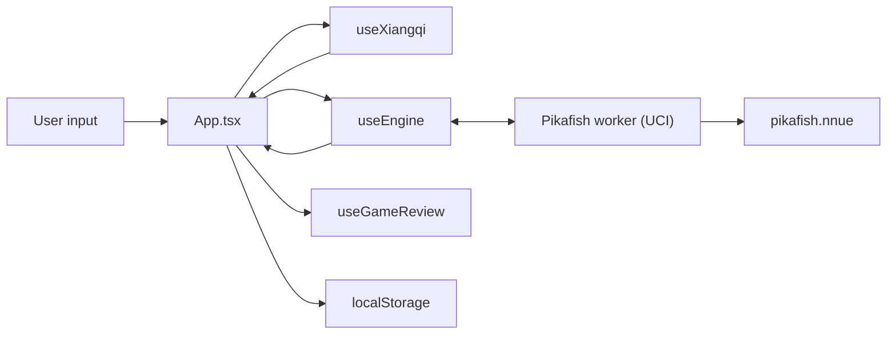

# Architecture

web-xiangqi is a single-page React app with Pikafish compiled to WebAssembly
and run in a Web Worker. Unusually for the three sibling apps, it also **builds
its own engine**: the repo carries the upstream patch set and Emscripten
overrides, and `npm run build` produces the `.wasm` artifacts the app ships.

Structured to mirror [web-katrain's `docs/architecture.md`][katrain], so the
three sibling apps can be read against each other. The third is
[web-chess][chess], which also carries [the cross-app learning plan][plan]
comparing all three and tracking what is worth moving between them.

[katrain]: https://github.com/Sir-Teo/web-katrain/blob/main/docs/architecture.md
[chess]: https://github.com/Sir-Teo/web-chess/blob/main/docs/architecture.md
[plan]: https://github.com/Sir-Teo/web-chess/blob/main/docs/cross-app-learning-plan.md

## Runtime Overview

## Two Halves of the Repo

The engine toolchain and the React app are largely independent, and most work
touches only one:

| | Engine | App |
| --- | --- | --- |
| Source | `patches/`, `templates/`, `scripts/build-pikafish.sh` | `src/` |
| Build | `npm run build` (needs emsdk) | `npm run build:react` |
| Output | `public/pikafish*.js`, `.wasm`, `.nnue` | `dist/` |
| Checks | `test:smoke`, `test:parity`, `bench:nps` | `npm test`, `npm run lint` |

`npm run build:react` deliberately cleans only the React output so the
checked-in engine artifacts survive.

## Main Thread

`src/App.tsx` is the application shell at ~4,950 lines: board, panels, modals
and all wiring. web-katrain moved the equivalent into a store; doing the same
here is the largest outstanding item in web-chess's
`docs/cross-app-learning-plan.md`.

- `src/hooks/` — `useXiangqi` (rules, move tree, game state), `useEngine`
  (worker lifecycle and UCI), `useGameReview` (the review pass),
  `useGameLibrary` (saved games).
- `src/utils/` — pure logic, and **where new logic belongs**: rules, review
  scoring, device tiering, persistence, the opening book, notation, export.
  Most of these now have a colocated `*.test.ts`.
- `src/components/` — board, panels, modals.

## Board Conventions

Easy to get backwards, and several tests exist only to pin them:

- Ranks run **bottom to top**: rank 0 is Red's back rank, rank 9 is Black's.
  FEN is written top to bottom, so `rank = 9 - visualRow`.
- Files `a`–`i` are 0–8. A square in UCI is file letter then rank digit (`e0`
  is Red's general at the start).
- Red is `'w'` and uses uppercase pieces; Black is `'b'` and lowercase.
- Evaluations are **Red-positive**, so Black loses ground when a score rises.

## Rules

`utils/xiangqi.ts` is the whole rule set: move generation, legality, check,
and the flying-general rule. `validateMoveStr` returns a reason on rejection,
which the tests assert against so a move is never rejected for the wrong rule.

## Engine Boundary

`useEngine` loads the lightweight `pikafish.js` wrapper first, then lazily
pulls the selected core and NNUE, so the app shell paints before the engine
arrives. It speaks UCI over `postMessage` and flushes `info` output to React
on an interval rather than per line.

Which core is loaded, how many threads, and how much hash come from
`utils/analysisProfile.ts`, which grades the device into `low` / `mid` /
`high`. Threaded cores need cross-origin isolation; the single-threaded cores
are the fallback where COOP/COEP are unavailable — which includes GitHub
Pages.

The tiering compares memory at 4, not 8, because **browsers disagree about the
top of `navigator.deviceMemory`'s range**. The spec describes clamping the
value to limit fingerprinting, and Chromium 148 was observed here reporting
`32`. The old `<= 8` test therefore put the same machine in the mid tier under
one browser and the high tier under another — sizing the engine by browser
rather than by machine. Every browser agrees that 4GB is constrained.

Engine crashes are classified rather than surfaced raw:
`shouldSuppressEngineRuntimeError` and `hasMemoryAccessOutOfBounds` keep a
WASM abort from reaching the user as an unhandled error, and a failed boot
can be retried with `saferBoot`, which drops to one thread and half the hash.

## Review and Accuracy

`utils/review.ts` scores a game on **winning chances, not centipawns**, using
Lichess's published constants — the sigmoid `0.00368208` and the accuracy
curve `103.1668 · e^(−0.04354·loss) − 3.1669`. A quality label takes the
milder of the raw centipawn reading and the practical one, so an imprecision
in a decided game is not called a blunder.

## Storage

| What | Key | Module |
| --- | --- | --- |
| Saved games | `xiangqi-game-library` | `utils/gameLibrary.ts` |
| Game in progress | `xiangqi-auto-saved-game` | `utils/autoSave.ts` |
| Preferences | `xiangqi-app-preferences` | `App.tsx` |

All localStorage, all capped, and everything read back goes through
`normalizeSavedGame`, which validates the start position against the actual
rules — two generals, both in their palaces, not facing down an open file, and
the side not to move not already in check. A record that fails is dropped
rather than reaching the board.

The auto-save stores a `SavedGame`, so restoring reuses that same validation.

`utils/serviceWorkerCleanup.ts` unregisters service workers from the older
demo build and clears its caches, so a stale shell cannot keep serving old
engine assets.

## Data Formats

- Moves are lowercase UCI (`h2e2`) everywhere, including the opening book.
- Export and import: `utils/gameExport.ts`, `utils/moveImport.ts`.
- Share links encode the tree as base64url: `utils/shareTree.ts`.
- The opening book is `utils/openings.ts`; a test replays every line through
  the rules engine so it can never advertise an unplayable move.

## The two grading ladders disagree, and the looser one wins

`classifyMoveQualityForEval` grades a move twice — once on centipawns, once on
winning chances — and keeps `getLessSevereReviewQuality` of the two. That is a
sound design *if* the two ladders are calibrated against each other. Here they
are independent constants, and measuring them shows they are not.

Taking each `REVIEW_THRESHOLDS` boundary and converting it to a winning-chance
loss at equality:

| boundary | centipawns | win% loss it really costs | `REVIEW_WIN_PERCENT_LOSS_THRESHOLDS` |
| --- | --- | --- | --- |
| best | 40 | 3.68 | 2 |
| good | 90 | 8.21 | 5 |
| inaccuracy | 180 | 15.99 | 20 |
| mistake | 320 | 26.46 | 30 |

The win-percent ladder is stricter at the top and looser in the middle, so they
cross. Because the milder grade wins, the looser ladder decides wherever they
disagree, and at the top the stricter one never bites at all. Measured at
equality, red to move:

- 30–90cp: the centipawn ladder is milder and wins. Harmless.
- **190–200cp: centipawns say mistake, winning chances say inaccuracy, and the
  move is graded an inaccuracy.**

That second case is the one that matters, because it happens *at equality* —
the position-aware argument for preferring winning chances does not apply when
the game is level. The centipawn ladder's own stated boundary is being
overridden by a number nobody calibrated against it.

web-chess does not have this: its win-percent thresholds are *derived* from its
centipawn ones, so the two meet exactly at equality and the milder-of-two is a
no-op safety net rather than a silent re-grading. See its
`WIN_PERCENT_LOSS_THRESHOLDS` and `qualityAgreement.test.ts`.

`gradingLadders.test.ts` records all of the above without changing any grade, so
editing either ladder now reports which grades moved and whether the two came
closer together or further apart — which is the information the decision below
actually needs.

Not changed here, for the reason recorded when the win-percent work was done:
altering either ladder changes grades users have already seen, and the right
ladder for xiangqi is a judgement about the game rather than something to copy
from chess. But the disagreement is now measured rather than assumed, and the
choice is between deriving one ladder from the other (chess's answer) or setting
both deliberately so they agree at equality.

## A mate wrecks the centipawn average here too

The same defect web-chess has, found by checking after it turned up there, and
larger. Not reproduced on screen — Pikafish would not load in the browser used
for this — so this is read from the code and the arithmetic, and should be
confirmed against a real mated game before it is fixed.

- `useEngine.ts` maps a mate to `MATE_SCORE_BASE = 30000` minus the distance.
  web-chess uses 10000, so the same mistake costs three times as much here.
- `getEvalLossForMove` subtracts raw and clamps only at zero, and
  `computeReviewArtifacts` sums that straight into `averageCentipawnLoss`.
- A side standing at -500 that plays into a forced mate therefore books a loss
  near 29,500. In a 40-move game that single move adds about 737 to the average.
- The *quality label* is unaffected, because `getWinningChancePercent` bounds
  the evaluation with `WIN_PERCENT_EVAL_LIMIT` before taking a winning-chance
  figure. So, exactly as in chess, the label stays sensible while the centipawn
  figure beside it does not.

**Fixed**, with the same 1000cp bound web-chess uses — one bug with two
constants, so one answer. Confirmed without the engine first: because
`useEngine` encodes the mate itself, the sentinel values are known and
everything after them is arithmetic. A six-move review whose ordinary moves cost
tens of centipawns was averaging 5017; `reportedCentipawnLoss` now bounds what
is summed, and the review note carries a "+" when it has been bounded rather
than showing a bound as though measured. The raw swing is still on the
annotation for anything that wants it.

## Project Invariants

- Ranks are bottom-up and evaluations are Red-positive. When in doubt, write
  the test first.
- New pure logic goes in `src/utils/` with a colocated test, not into
  `App.tsx`.
- A mobile-like device is always the `low` tier; `resolveEngineBootConfig`
  depends on that and a test pins it.
- Storage readers must never throw on bad data; drop the record and move on.
- If the eval graph ever goes blank rather than wrong, suspect a non-finite
  `evalScore`. `EvalGraph` carries the last seen value forward with
  `typeof x === 'number'`, which admits `NaN`, and a single `NaN` reaches the
  SVG path and invalidates the whole line rather than one point. Left as-is
  because the loose check is the house idiom here and nothing has been shown
  to produce a `NaN` score — but it is the first place to look.

  The review path is worth contrasting, because it is safe for a reason worth
  copying rather than by luck: `clampWinPercentLoss` returns 0 for anything
  non-finite, and every accuracy figure — the summary, the per-side split, the
  per-phase breakdown — is derived through it. One guard at the boundary makes
  everything downstream safe without each display having to re-check. `EvalGraph`
  has no such boundary, which is why it is the exposed one.

  Both siblings already handle this, and they do not handle it equally well —
  worth knowing before copying the nearer one:

  - **web-chess** drops the point (`if (!isFiniteNumber(cp)) continue` in
    `buildWinrateSeries`). Safe, but the line then joins the surrounding points
    as though nothing were missing, which reads as data rather than a gap.
  - **web-katrain** breaks the path instead. `buildPath` sets `started = false`
    on a non-finite value, so the stroke stops and restarts afterwards: the gap
    is visible as a gap and the rest of the line survives. It also filters
    non-finite values before taking min/max for the scale, since one `NaN`
    would otherwise poison the axis, and walks backwards for the last finite
    value rather than assuming the final one is usable.

  katrain's is the one to copy. It is the only one of the three that keeps a
  missing evaluation *legible* rather than merely non-fatal, and it guards the
  scale as well as the stroke.

  That second failure is real here, not hypothetical — checked in
  `EvalGraph.tsx`. The clamp does not strip a bad value, because
  `Math.max(-limit, Math.min(limit, NaN))` is `NaN`; and the extent is taken
  with `points.reduce((best, p) => Math.max(best, p.eval), -Infinity)` and its
  minimum counterpart, so one `NaN` makes the whole extent `NaN` and the axis
  with it. So a single bad evaluation would take out the scale as well as the
  line, and fixing only the stroke would leave the graph broken. Both halves are
  one change or neither.
- The checked-in engine artifacts in `public/` are the shipped engine.
  `build:react` must not delete them.
- A capability value read from a browser API needs its documented range
  checked before a threshold is chosen against it.
