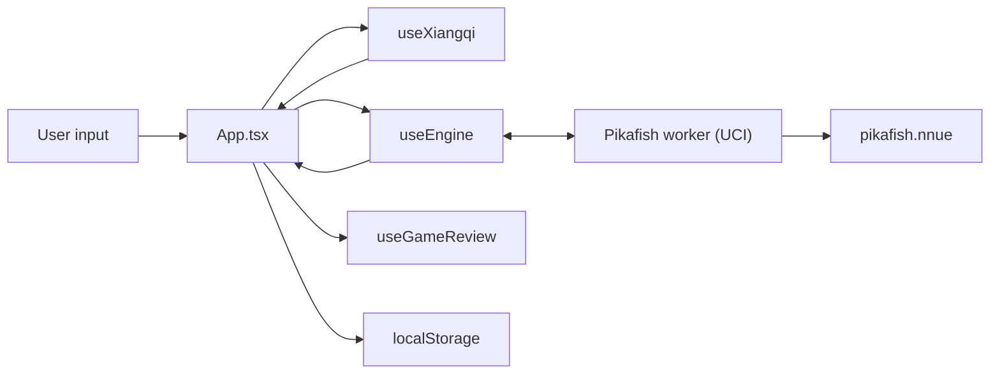

# Architecture

web-xiangqi is a single-page React app with Pikafish compiled to WebAssembly
and run in a Web Worker. Unusually for the three sibling apps, it also **builds
its own engine**: the repo carries the upstream patch set and Emscripten
overrides, and `npm run build` produces the `.wasm` artifacts the app ships.

Structured to mirror [web-katrain's `docs/architecture.md`][katrain], so the
three sibling apps can be read against each other. The third is
[web-chess][chess], which also carries [the cross-app learning plan][plan]
comparing all three and tracking what is worth moving between them.

[katrain]: https://github.com/Sir-Teo/web-katrain/blob/main/docs/architecture.md
[chess]: https://github.com/Sir-Teo/web-chess/blob/main/docs/architecture.md
[plan]: https://github.com/Sir-Teo/web-chess/blob/main/docs/cross-app-learning-plan.md

## Open questions

Everything below that is waiting on a decision rather than on work, collected
because they are spread across a long document. Each one has the measurements
beside it in its own section; what is listed here is the question.

| Question | What is wanted |
| --- | --- |
| [A four-core desktop is graded as a phone](#a-four-core-desktop-is-graded-as-a-phone-open-question) | Nodes/second and engine-ready time on a real four-core machine running the threaded core. |
| [The phone half of that clause](#the-phone-half-of-that-clause-has-never-been-measured) | The same, on a real phone, plus what a sustained threaded search does to battery. A 390px viewport currently takes the single-threaded core whatever the hardware says. |
| [Whether collapsing a toolbar should give its row back](#there-is-a-third-option-and-it-is-the-one-still-open) | A decision about how the collapse should feel. It vacates a row and hands the board nothing, which is a control that does not do what it looks like it does — but reclaiming the row resizes the board on every toggle. No longer urgent: the board's floor fixes the reader this was for. |

## The one thing that leaves the machine

Everything here runs locally: the engine is WebAssembly in a worker, the
library is localStorage, a share link is a URL the reader copies. The
exception is the cloud book. `src/hooks/useCloudBook.ts` asks
`https://www.chessdb.cn/chessdb.php?action=queryall&board=<fen>` for the
position on the board, and only while the reader has turned the card on; the
preference is off by default and the card says what is sent. Replies are
cached per FEN for the life of the page (`src/utils/cloudBook.ts`), a failed
request is not cached, and a reading is drawn only for the position it was
fetched for -- the frame between a navigation and its fetch used to show the
previous position's moves under the new side's label. The service answers a
plain cross-origin GET from a browser page; that was checked from this app
before the hook was written, and the recorded reply for the start position is
the parser's test fixture.

## Runtime Overview



## Two Halves of the Repo

The engine toolchain and the React app are largely independent, and most work
touches only one:

| | Engine | App |
| --- | --- | --- |
| Source | `patches/`, `templates/`, `scripts/build-pikafish.sh` | `src/` |
| Build | `npm run build` (needs emsdk) | `npm run build:react` |
| Output | `public/pikafish*.js`, `.wasm`, `.nnue` | `dist/` |
| Checks | `test:smoke`, `test:parity`, `bench:nps` | `npm test`, `npm run lint` |

`npm run build:react` deliberately cleans only the React output so the
checked-in engine artifacts survive.

## Main Thread

`src/App.tsx` is the application shell at ~5,300 lines: board, panels, modals
and all wiring. web-katrain moved the equivalent into a store; doing the same
here is the largest outstanding item in web-chess's
`docs/cross-app-learning-plan.md`.

- `src/hooks/` — `useXiangqi` (rules, move tree, game state), `useEngine`
  (worker lifecycle and UCI), `useGameReview` (the review pass),
  `useGameLibrary` (saved games).
- `src/utils/` — pure logic, and **where new logic belongs**: rules, review
  scoring, device tiering, persistence, the opening book, notation, export.
  Most of these now have a colocated `*.test.ts`.
- `src/components/` — board, panels, modals.

## Board Conventions

Easy to get backwards, and several tests exist only to pin them:

- Ranks run **bottom to top**: rank 0 is Red's back rank, rank 9 is Black's.
  FEN is written top to bottom, so `rank = 9 - visualRow`.
- Files `a`–`i` are 0–8. A square in UCI is file letter then rank digit (`e0`
  is Red's general at the start).
- Red is `'w'` and uses uppercase pieces; Black is `'b'` and lowercase.
- Evaluations are **Red-positive**, so Black loses ground when a score rises.

## The board's animation, and the three things that had to be true

`Board.css` has given `.piece` a 300ms `left`/`top` transition since the board
was written, and it had never once fired. Pieces teleported. Measured rather
than read off the code, because the stylesheet looks correct and so does the
component: stepping one move back on a loaded game ran **zero** `transitionrun`
events and replaced exactly one of the 31 piece nodes.

Three separate things stood between that stylesheet and a moving piece, and
each of them fails in a way that looks like success from the other side. Worth
reading in order, because fixing any one alone leaves a bug that is *harder* to
see than the original.

1. **A piece must keep its DOM node across a move.** The elements were keyed by
   the square they stood on, so a move unmounts the element on the source square
   and mounts a different one on the destination; a freshly mounted element has
   no previous `left` to transition from. `utils/pieceIdentity.ts` carries
   identity across a single move instead.
2. **The pieces must render as one flat list.** React scopes keys to the array
   they sit in, and the pieces were a nested `ranks.map(files.map(...))` — one
   sub-array per rank. A piece changing rank crosses between two sibling arrays
   and is remounted however stable its key is. With the key fixed and the nesting
   left alone, a same-rank move animated and every rank-changing move did not,
   which is a state that reads as "the animation works" if the first move you try
   is a cannon along a rank.
3. **The list must be ordered by identity, not by square.** Ordered by square, a
   move is an array *reorder*, and React moves the DOM node as well as restyling
   it. That was directional: stepping back animated and stepping forward jumped
   the whole distance on the first frame. Sorting on the id — which never changes
   for a piece — means a move changes only `left`/`top`, which is what the
   transition is written against.

### Identity is carried across one move, and rebuilt for anything else

`nextPieceIdentityState(previous, board)` diffs two boards and transfers the
moving piece's id when they differ by exactly one move. Anything larger — loading
a game, clicking into the move tree, opening a variation — bumps a generation and
rebuilds every id, so nothing slides along a path no move ever took.

The diff is deliberately direction-agnostic, because stepping *back* is the
navigation a reader performs most and it is the same shape in reverse:

| | source square | destination square |
| --- | --- | --- |
| play `h2e2` capturing | `C` → `''` | `c` → `C` |
| undo it | `''` → `C` | `C` → `c` |

The pairing is found by asking which of the two changed squares holds, afterwards,
the piece the other held before. That is true of exactly one ordering unless two
pieces swapped, and one move cannot swap two pieces — so both orderings matching
is refused rather than guessed at. Undoing a capture also puts a piece back on the
square the mover left, and that piece is new to the DOM: it takes a fresh id
rather than inheriting the one that just travelled away from it.

**The browser gate asserts where the piece is painted, not which events fired.**
`transitionrun` did not fire for the forward step even while the node persisted,
so it is not a signal about the thing a reader can see. The gate samples the
piece's box for a dozen frames and asks whether it was ever caught part of the
way; it does that in both directions, because one direction passing is exactly
what bug 3 looked like, and it asserts that a *jump* is not animated, because
carrying identity too eagerly is the other way to get this wrong.

## Dragging a piece

Added beside click-to-move rather than in place of it, and the awkward part is
why the piece is **not** selected on `pointerdown`, which is the obvious place
for it. `onSquareClick` reads a second call on the same square as "deselect", so
selecting on press would make every plain click select and immediately let go.
Selection happens instead the moment the pointer crosses a four-pixel threshold,
which leaves a press that never moves as an ordinary click and every existing
path untouched. The gate pins both selection behaviours for that reason.

`draggableSide` is one prop rather than two because the board needs the same
answer for both halves of the question: a piece is draggable when its owner is
to play *and* the caller is taking moves at all. `handleSquareClick` already
refuses the engine's turn and a finished game, but refusing after the piece has
been dragged across the board is not the same as never offering the grab cursor.

**Mouse only, deliberately.** A touch drag wants `touch-action: none` on the
squares, which takes the board out of the page's scrolling, and the long press is
already spoken for by board markers. Tap-a-piece, tap-a-square is the better
phone interaction regardless.

## Rules

`utils/xiangqi.ts` is the whole rule set: move generation, legality, check,
and the flying-general rule. `validateMoveStr` returns a reason on rejection,
which the tests assert against so a move is never rejected for the wrong rule.

### Repetition, and the rule that is not chess's

`utils/repetition.ts` is the other half, and it is the part xiangqi does
differently. A repeated position is not a draw here: the side that will not
stop checking is ruled to have **lost**, and the same goes for perpetually
chasing an unprotected piece. `gameResultForPosition` had this written down as
a comment and no code, so a player shuffling into a perpetual check saw
nothing at all.

`describeRepetition` counts occurrences along the played line and classifies
the cycle since the previous visit to the same position. A side that checked
on every one of its moves in that cycle is checking perpetually; one quiet
move ends it, which is exactly the out the rules give the checker. The board
shows a Repetition panel naming the side that has to vary.

**It stops short of chases, deliberately.** 長捉 needs to know which piece is
chased, whether it is protected, and whether the chaser threatens it or merely
stands near it, and the rulebook carves out pinned pieces, a chased piece that
is itself checking, and chasing with a general or a soldier. A guess there
would put a wrong verdict on a real game, so an unclassified cycle says "a
draw unless one side is perpetually chasing" rather than claiming to have
ruled a chase out. Nothing in the module ends a game on its own.

Position identity excludes the move counters, which differ on every visit and
would make every position unique.

## Notation

`utils/xiangqiNotation.ts` writes a move the way players read it. UCI is the
wire format and the right thing to store; it is the wrong thing to show,
because every Chinese book, every database and the World Xiangqi Federation's
own records write the first move as 炮二平五 or `C2=5`. A Move Notation
preference picks between UCI, WXF and Chinese, and it reaches the move list,
the breadcrumb, the engine's principal variations, the opening book, the
review's key moments and the eval graph's tooltip.

Three rules are easy to get backwards and all three are pinned by tests:

- **Files are numbered from each player's own right**, so the two sides
  disagree about every file except the middle one they both call five. Red's
  number is `9 - fileIndex`, black's is `fileIndex + 1`.
- **The trailing number is a distance after `+`/`-` but a destination file
  after `=`** -- and for the horse, elephant and advisor, which never move
  straight, it is a destination file either way. `R2+3` is three ranks;
  `H2+3` is a file.
- **Two of a kind on one file lose the file number** and take `+` for the one
  nearer the opponent and `-` for the one behind. "Nearer the opponent" is the
  higher rank for red and the lower for black. Only soldiers stack deeper than
  two, and then the letter goes instead and they are counted from the front.

A principal variation is **replayed**, not formatted move by move against the
starting position: which chariot is the front one, and whether a file number
needs disambiguating at all, both change as the line runs.

WXF has no answer for two files each holding a stacked pair, where `+R+1`
names two different moves; this keeps the file number in that one case. The
guarantee that matters is in `xiangqiNotation.test.ts`: it walks every legal
move in six positions and asserts no two produce the same string, because a
record is only readable if each move in it names exactly one move.

### Reading it back

`parseMoveInNotation` is the formatter run backwards, literally: it generates
the legal moves in the position and asks which one *writes* as the text it was
given. A few dozen formats per token is nothing, and it buys two properties a
hand-written parser cannot have. It can never accept an illegal move, because
it only ever offers legal ones; and it can never disagree with the formatter
about what a move is called, because it is asking the formatter. A test round
trips every legal move in five positions through both notations.

`canonicaliseNotationToken` folds the differences that are spelling rather
than meaning -- simplified against traditional, the red/black glyph split that
real records ignore, Chinese numerals against Arabic, `.` against `=`, case,
full-width characters -- and then requires the result to match one of the five
shapes a move can take. That last part is not optional: without it `2...`
folds to `2===` and a move number starts reading as a move.

Two things worth knowing before reading this code, both of which looked
plausible the other way round and are wrong:

- **The opening position is symmetric and files are numbered from each
  player's own right, so the same token names a move for either side.** `C2=5`
  is red's cannon to the middle *and* black's. That is the notation working.
- **Black's 车9平8 is the chariot on i9, not a9.** Black's file 9 is the i
  file.

The import box falls back to this when the UCI extractor finds no coordinates,
so a PGN carrying a Chinese comment is still read as a PGN. Variations are not
followed on that path: the parenthetical form is a PGN convention that a
notation record does not use.

#### Skipping a token is not the safe option

The reader walks a record token by token. Anything that is not a move -- a move
number, a result, a word from a comment -- has to be skipped, because records
are full of them. Anything that *is* a move and cannot be placed has to stop the
read. Getting that distinction wrong is the same bug three times over, and it
does not look like a bug:

> `1. C2=5! H8+7` imported as `b0c2`. One move, belonging to neither half of
> that line, with nothing rejected, no error and no notice.

The mechanism is worth understanding once, because it is what makes the failure
silent rather than loud. Skipping a token that carried a move leaves the board a
move behind. The next token is then matched against a position the record never
reached -- and the opening is symmetric with files numbered from each player's
own right, so a reply written for one side is very often a legal move for the
other. It parses. It is a real move. It is not the game.

Three token shapes reached that path, all of them ordinary:

- **an annotated move** -- `C2=5!`, 馬8進7?!, a `+` for the check;
- **a move number written against the move** -- `1.C2=5`, `１．炮二平五`,
  which is simply how some databases write it;
- **Chinese notation for a file stacked deeper than three**, where the shape
  table listed the WXF half (`35+1`) and not the Chinese one (三兵進一, folding
  to `3P+1`). The formatter had been writing both all along, so those records
  could be produced by this app and not read back by it -- while the same game
  in WXF imported cleanly, which is what kept it hidden.

Two rules follow, and both are load-bearing:

1. **Canonicalisation folds decoration around a move, not just spelling inside
   it.** A trailing run of `! ? + #` and a leading move number are stripped.
   The move number needs its separator to count as one, because a Chinese token
   may *open* with a numeral that belongs to the move -- 四兵進一 is a soldier,
   not move four.
2. **A move-shaped token that names no legal move ends the read.** It used to
   be skipped, and the moves after it were imported from a position the record
   never reached: `C2=5 H8+7 R5=9 H2+3` arrived as a three-move game whose third
   move was played from the wrong board. What comes back now is a true prefix,
   and the importer says which move stopped it.

Rule 2 also bounds the cost, which previously needed a magic number. Reading one
token costs a full legal-move generation plus writing every legal move in both
notations; `maxMoves` bounds only the tokens that *matched*. A paste of 40,000
move-shaped tokens naming nothing therefore paid that price 40,000 times --
inside the import box's own 200,000-character limit. Stopping at the first one
costs one.

Measured in a browser rather than inferred from the unit suite, since the claim
is about a frozen tab and vitest runs in Node. Longest stall of the main thread,
found by watching a `requestAnimationFrame` ticker stop:

| paste | skipping and reading on | stopping at the first |
| --- | --- | --- |
| 40,000 tokens naming nothing | 4431ms | 57ms |
| 40,000 Chinese tokens | 4002ms | 29ms |
| a real 120-ply record | 29ms | 29ms |

Four and a half seconds is not slow, it is a page that has stopped answering.
The real record is unaffected either way, which is the point: the bound costs
nothing to anyone pasting an actual game.

## Engine Boundary

`useEngine` loads the lightweight `pikafish.js` wrapper first, then lazily
pulls the selected core and NNUE, so the app shell paints before the engine
arrives. It speaks UCI over `postMessage` and flushes `info` output to React
on an interval rather than per line.

Which core is loaded, how many threads, and how much hash come from
`utils/analysisProfile.ts`, which grades the device into `low` / `mid` /
`high`. Threaded cores need cross-origin isolation; the single-threaded cores
are the fallback where COOP/COEP are unavailable — which includes GitHub
Pages.

The tiering compares memory at 4, not 8, because **browsers disagree about the
top of `navigator.deviceMemory`'s range**. The spec describes clamping the
value to limit fingerprinting, and Chromium 148 was observed here reporting
`32`. The old `<= 8` test therefore put the same machine in the mid tier under
one browser and the high tier under another — sizing the engine by browser
rather than by machine. Every browser agrees that 4GB is constrained.

### A four-core desktop is graded as a phone (open question)

`detectDeviceTier` sends anything with `hardwareConcurrency <= 4` to the `low`
tier, which means the single-threaded core, one thread, and a 16–24MB hash. That
clause fires on *machine shape alone*, so it catches a four-core laptop with a
mouse and a 1440px window as surely as it catches a phone — the `mobileLike`
flag beside it does not have to be true.

What it costs, measured here at low-tier settings (24MB hash, depth 16, median
of three):

| threads | 1 | 2 | 3 |
| --- | --- | --- | --- |
| nodes/second | 430k | 858k | 1.32M |

Two threads is twice the search, and the budget is `movetime`, so twice the
search is what a player actually gets. A four-core machine promoted to `mid`
would take `threadsForCores(4, 2, 6)` = 2 threads and leave two for the browser.

It is left alone for now because the gain is measured and the cost is not. The
`mid` tier loads the *threaded* core, which prewarms a twelve-worker pthread
pool; boot cost for that was measured on an eighteen-core machine (333ms at 4
threads, 378ms at 8) and nothing here has measured it on a genuinely four-core
one, which is the only machine the change affects. Simulating it by overriding
`hardwareConcurrency` does not answer the question — it changes what the app
asks for, not what the machine can give.

Two guards already narrow the blast radius, and would still apply: a device
reporting 4GB or less stays `low` on the memory test, and a coarse pointer or a
viewport under 700px stays `low` on `mobileLike`. So the population in question
is specifically three- and four-core machines with a fine pointer, a large
window, and more than 4GB — desktops and laptops, not phones. **Wanted before
changing it: engine-ready time and nodes/second on a real four-core machine,
threaded core, and confirmation the UI stays responsive while the search runs.**

#### The phone half of that clause has never been measured

The question above is about four-core desktops and says the `mobileLike`
guards "would still apply". Worth being explicit about what they do, because
the cost is the same table and the justification is not written down anywhere.

Measured against the deployed site, varying only the viewport:

| viewport | core fetched |
| --- | --- |
| 390x844 | `pikafish-core-single-simd.js` |
| 768x1024 | `pikafish-core-simd.js` |
| 1440x900 | `pikafish-core-simd.js` |

The browser reported 18 cores, 32GB and `crossOriginIsolated: true` in all
three. Nothing but `minViewport < 700` sent the first one to the single-threaded
core — hardware does not get a vote. By the table above that is 430k nodes per
second against 1.32M, on a `movetime` budget, so it is a third of the search.

This is emulation on desktop hardware, which is exactly the case that cannot
settle it: a real flagship phone reports eight cores, not eighteen, and has
thermal and battery limits a desktop does not. There are good reasons to be
careful on a phone and none of them are recorded here — which is the point.
**Wanted, and it is the same shape as the four-core question: nodes/second and
engine-ready time on a real phone running the threaded core, plus what it does
to battery and to a sustained search, before anyone lets hardware outvote the
viewport.**

### The thread ceiling is the build, not the device policy

**Read this before raising the thread count.** `WASM_PTHREAD_POOL_SIZE` in
`scripts/build-pikafish.sh` prewarms that many pthread workers into the shipped
core, and it is not merely a warm-up. The engine runs inside a worker, so when
Pikafish asks for more search threads than the pool holds, the thread that asked
blocks in `pthread_create` and never returns to the event loop that would start
the new worker. Nothing errors: the engine simply never answers `readyok`, and
the app sits on "Loading engine" until the 90-second ready timeout fires.

The pool was 4, which cost most of the machine's search. It is now 12, and
`MAX_ENGINE_THREADS` stops the ask at 8 — `ENGINE_THREAD_HEADROOM` below the
pool, because the two used to be the same number and there was nowhere to be
wrong by one. `threadsForCores` applies that clamp, so a tier edit alone cannot
reach the hang.

Measured in the browser on the rebuilt SIMD core, depth 18 from the start
position, 256MB hash, 18-core machine:

| threads | 1 | 4 | 8 |
| --- | --- | --- | --- |
| nodes/second | 435k | 1.92M | 3.74M |
| wall | 2501ms | 1407ms | 625ms |

Node agrees at depth 20 — 448k / 1.80M / 3.51M — and shows 12 threads *slower*
than 8 on this machine (3.28M), which is why the ask stops at 8 rather than at
the pool. Boot cost is not what the bigger pool costs. Warm: ready in 333ms at 4 threads,
378ms at 8. Cold -- a fresh browser context, nothing cached -- the board is on
screen in about 110ms and the engine is ready in about 550ms, measured over
three runs.

The threaded core is only ever loaded on the mid and high tiers, which are
always a pointer-and-keyboard machine, so the larger pool never reaches a phone:
the low tier boots the single-threaded core, which has no pool at all.

Raising this further means raising `WASM_PTHREAD_POOL_SIZE` *and* rebuilding the
artifacts, together — `WASM_PTHREAD_POOL_SIZE=<n> npm run build`, which needs
emsdk. A source-only raise would let a tier ask for more than the shipped core
was built for.

**Four places know the pool size, and `test:engine:contract` makes them agree:**
the build script's default, the built artifacts themselves,
`ENGINE_PTHREAD_POOL_SIZE` in `analysisProfile.ts`, and `templates/pikafish.js`
— which needs it because it clamps a caller's explicit thread count, and
`Pikafish.createWorkerEngine` is a published helper. Unclamped, a browser asking
for 16 threads got a worker that timed out with nothing to read; 64 booted fine
in the same run, so the failure is timing-dependent and not findable by trying
once. Node is not clamped: the pool is a browser-worker concept and the same
artifacts run 17 threads there, which is what `bench:nps` does.

The check also compares `public/pikafish.js` and `dist/pikafish.js` against the
template they are copied from. Editing the template without rebuilding leaves
the app loading the old wrapper, and the shipped copies were 35 lines behind
when that check was added.

### The deployed site is single-threaded, and every number above is not it

**The table above is a dev-server measurement.** `vite.config.ts` sends COOP and
COEP, so every dev server and every browser check in this repo is cross-origin
isolated, gets `SharedArrayBuffer`, and loads a threaded core. **GitHub Pages
sends neither header and cannot be configured to** — it serves static files with
fixed ones. So the build a player actually loads always takes the other branch.

Same build, same machine, same start position, the only difference being the
headers on the response:

| | cross-origin isolated | GitHub Pages |
| --- | --- | --- |
| core | `threaded-simd` | `single-simd` |
| threads | 8 | 1 |
| nodes/second | 3.7M | 414k |
| live analysis settles at | D22/S49 | D16/S30 |
| engine ready | ~1.2s | ~0.4s |

Nine times the nodes and six extra plies — which is what the deployed site used
to give up, and no longer does.

**`public/coi-sw.js` puts the headers back.** A service worker sees every
same-origin response before the page does, so it can add what the host omitted;
`index.html` registers it and reloads once so the document comes back through
it. The chain is unchanged — threads need `SharedArrayBuffer`, which needs
isolation, which needs those headers — but the headers no longer have to come
from the host. Measured over a server sending none, MultiPV 3:

| | Pages as-is | Pages + `coi-sw.js` |
| --- | --- | --- |
| core | `single-simd` | `threaded-simd` |
| threads | 1 | 8 |
| nodes/second | 479k | 3.9M |
| seldepth | 31 | 41 |
| hash used | 4% | 26% |

It caches nothing on purpose. The cleanup this repo carries exists because an
older demo shipped a *caching* worker and a stale one went on serving old engine
artifacts; this one only rewrites headers on responses it fetches from the
network, so there is no cache to go stale and no build that can outlive a
deploy. Offline support is the other half of what web-chess's worker does and is
deliberately not here.

Every branch fails safe — no worker support, an insecure context, a rejected
registration, or a worker that never controls the page all leave the app
single-threaded and working. The one reload carries a sessionStorage guard so it
cannot become a loop, and the block is skipped entirely when the page is already
isolated, so the dev server and every check here register nothing. Hosting that
sends the headers itself (Netlify, Cloudflare Pages, a Worker) still skips the
worker and the reload with it.

**The reload is cheap, and it is not free.** It fires before the engine is
fetched: on a first visit the pre-reload document takes two JavaScript responses
and no engine assets at all, so the 710KB core and the 53MB NNUE are downloaded
exactly once, after it. A shared link survives it intact -- `?moves=` is
preserved across the reload, the position reloads to the same ply, and no
restore prompt appears.

What it does cost is one extra page load for devices that gain nothing from
isolation. The `low` tier loads the single-threaded core whatever the headers
say, so a phone -- and a four-core desktop, per the tiering question above --
pays a reload for a capability it will not use. Skipping it would mean deciding
the tier inside `index.html`, before React exists, which duplicates
`detectDeviceTier` into a second place; the pool-size bug is what four copies of
one constant looks like when they drift. Two JavaScript responses is the
cheaper mistake.

**Reload on `controllerchange`, never on `navigator.serviceWorker.ready`.** The
two look equivalent and differ exactly where it matters. `ready` resolves as
soon as *a* registration has an active worker — and a returning visitor still
carrying the old demo worker has one, so it resolved against that, the reload
fetched a second document that had also not been through `coi-sw.js`, and the
sessionStorage guard spent itself on it and blocked the reload that would have
worked. Everyone who had used the site before stayed single-threaded, silently
and permanently. Only the controller being `coi-sw.js` means the next fetch goes
through it. `test:prod:smoke` has a third pass for this: it installs the legacy
worker first, then loads the app as a returning visitor would, because the other
two passes start from a clean browser where ours is the first worker and the
race cannot happen.

What *was* wrong is that the app did not know. Threading was resolved entirely
inside `templates/pikafish.js` — `resolveVariant` drops `threaded-simd` to
`single-simd`, `recommendedThreads` returns 1 for a non-threaded core — so the
engine was always asked for one thread and always got it. But nothing told the
app, and the app draws the dashboard. The deployed Core card read `single-simd`
and `8T · 128MB` at the same time, and Settings offered an Engine Threads ladder
— 1 2 3 4 6 8 — on which every rung was 1.

`detectThreadSupport` now sits beside `detectSimdSupport` and mirrors the
wrapper's own check, and `resolveEngineBootConfig` resolves it the way it
already resolves `saferBoot`: single variant, one thread. The count, the ladder
and the Core card's explanation all read that one config.

**Time budgets absorb this and depth ceilings do not**, which is the reason the
budget is `movetime` and the depth is a ceiling (see below). At 414k nps the
same budget simply arrives at a shallower depth instead of overrunning. Game
Review is unaffected in the way that matters — measured on a Pages-like server,
the calibration fixtures score 99% for engine self-play and 6% for arbitrary
legal moves, a 93-point separation against a gate that asks for 40, with a
30-ply review taking 10.8s. Strong play scores *higher* single-threaded, not
lower: a shallower reviewer disagrees with the played move less often.

`test:prod:smoke` runs both configurations for this reason. It used to run only
`vite preview`, which is isolated — so the deploy gate had never once loaded the
app the way the deploy serves it. Its second pass now asserts that the worker
reaches isolation and a threaded core, and the invariant that failed here in the
first place: that the dashboard's thread count agrees with what the page
actually got.

### What a visit costs

Measured against a server sending what GitHub Pages sends -- an ETag,
`Last-Modified` and `max-age=600` -- with the profile kept between visits:

| | responses | bytes from the server |
| --- | --- | --- |
| first visit, cold | 9 | 55,054,236 |
| every visit after | 1 | 0 |

The one response on a repeat visit is the weights revalidation answering 304.
Everything else -- the bundle, the stylesheet, the core and its wasm -- comes
from the browser's own cache and never reaches the server.

It was not always the second row. `pikafish.nnue` is 53,719,310 bytes, and **a
browser HTTP cache will not store a single entry that large**: the 710KB core is
served from cache on a second fetch and never asked for again, while the weights
were requested unconditionally every time, at full size, on every visit. The
ETag never came into it, because there was nothing stored to revalidate. A plain
`fetch` from a bare page with no service worker behaves the same way, so it is
neither the worker nor the engine.

`public/coi-sw.js` keeps them in Cache Storage instead, which has no per-entry
limit. **It always revalidates.** That is the whole reason it is safe here,
where `serviceWorkerCleanup` exists because a cached engine artifact once
outlived a deploy: a stored copy is never served on its own authority, every
load sends a conditional request carrying the stored validator, and the cached
body is used only when the server answers 304. What is saved is the body, not
the round-trip. A response carrying no validator is not cached at all, since
there would be no way to ask whether it had changed -- on such a host nothing is
stored and the app is unaffected.

Replacing the net is a 200 with the new body and then 304s again, which was
measured rather than assumed.

**Compression is not a lever, and the first visit is what it is.** Pages already
applies `content-encoding: gzip` to the weights and the result is *larger* than
the file -- 53,728,090 bytes against 53,719,310 -- because a quantised net is at
its entropy limit; `gzip -6` locally agrees to within a few bytes. The only
thing that would move the first visit is a smaller net, which is a playing
strength decision rather than a delivery one: `scripts/build-pikafish.sh` takes
whatever `pikafish.nnue` upstream ships. Upstream ships one -- `evaluate.h`
defines `EvalFileDefaultNameBig` and no small counterpart -- so there is nothing
to choose between.

**So the wait cannot be shortened, and what was wrong is that it was
unexplained.** "Loading engine" stood alone for the whole download, which on a
phone connection is a minute or more with a board that has no evaluation and
nothing saying why -- indistinguishable from an engine that is never coming.
`templates/pikafish.js` now reads the body as a stream and posts the byte count
out of the worker, and the status line reads `Loading engine · 21 of 53 MB`.

Three things about that are not obvious:

- **The page cannot measure this itself.** The weights are fetched *inside the
  engine's worker*, and a worker's fetches are in neither the document's
  resource timing nor its network events. This is the same fact that made
  "telling whether the engine is up" hard to measure, above. The count has to
  come from the wrapper.
- **`content-length` is the encoded length**, and Pages gzips the net -- to
  slightly more than it started as. The declared total is therefore close but
  not exact, and a decoded body can outrun it, so the percentage clamps.
  It is used as a capacity hint for the buffer too, which grows if the body
  passes it: collecting chunks and joining them at the end would hold two
  copies of 53MB at once on the device least able to afford it.
- **The phone gets a percentage instead of the word, not beside it.** That chip
  lives in the header measured at 40px against 66px in the note above; "Loading
  24%" wraps it onto a second row, which moves the board down for the whole
  download and back up when the engine arrives. `40%` is narrower than
  `Loading`. The sentence is on the label and the title.

#### The bundle is not where the load time is

Worth writing down because the 393kB main bundle is the number a build log puts
in front of you, and splitting it further is the obvious next idea.

`dist/assets/index-*.js` is 393,713 bytes. A cold visit is 55,054,236. The
bundle is **0.7% of it**, and `pikafish.nnue` is 97.6%. Splitting the bundle
harder would move a fraction of a percent of what a first visitor waits for,
and nothing at all for a returning one, who fetches zero bytes. The engine is
already lazy, so the shell paints without waiting for any of it.

A throttled measurement was attempted and is deliberately not quoted here. The
isolation bootstrap reloads the page once when the service worker takes
control, which lands in the middle of a timed load and destroys the execution
context the measurement is running in; the numbers that survive that are of the
reload, not of the load. The byte accounting above answers the question without
it.

### A core that arrives as something else

Running the browser suites back to back on one machine produced an intermittent
boot failure — twice in three attempts, never when `test:ui:layout` ran alone:

```
Failed to boot Pikafish engine
Error: PikafishCoreSingleSimd not found. Load pikafish-core-single-simd.js first.
    at getCoreFactory (pikafish.js:277)
```

The message is misleading, which is most of why it was hard to place.
`importScripts` throws when a request *fails*, and does not when one succeeds
carrying the wrong body — a dev server under load, a captive portal, a CDN error
page all answer 200 with something that is not the core. The import returns
having defined nothing, and the first thing to notice is `getCoreFactory`, which
reports a missing global as though the caller had forgotten to load it.

The worker now checks the global immediately after importing, retries once with
a cache-busting query, and if it is still missing says that the request
succeeded and did not return the core.

**What that is known to do, and what it is not.** Serving a deliberate
non-engine body for the first request of the core makes the retry fire — the
`?pikafish-retry=1` request appears in the network log and the engine reaches
ready with a clean console — so the detection and the recovery both work at the
import step. It is *not* established that this changes the outcome of the
failure above: the app carries its own boot recovery, and in that constructed
scenario it reached ready either way. The full suite sequence has run clean
twice since, against two failures in three before, which is evidence and not
proof.

### The emsdk version is part of the engine, and is pinned

`install-emsdk.sh` used `EMSDK_VERSION=latest`, so the Pages deploy compiled the
engine with whatever emsdk was current that morning. That is not a
reproducibility nicety: today's `latest` ships a threaded core that never
becomes ready.

Emscripten **6.0.2** dropped `mainScriptUrlOrBlob` from
`INCOMING_MODULE_JS_API`, and `templates/pikafish.js` passes exactly that. The
engine module is constructed inside a worker, where `document.currentScript`
does not exist, so Emscripten's own `_scriptName` is undefined; without the key
it spawns every pthread worker as `new Worker(undefined)` — a request for the
literal path `"undefined"`, a 404, and a pool whose load dependency never
clears.

Nothing in the pipeline catches it, which is the part worth remembering:

- the changelog promises an error in *debug* builds, and this build sets
  `ASSERTIONS=0`, so the ignored key is silent;
- `test:smoke` and `test:parity` pass, because they run under Node, which never
  takes the worker path;
- the browser suite that would see it lives in `ci.yml`, and the deploy job does
  not wait for `ci.yml`.

So an engine change is only proven by watching a real browser reach `readyok`.
6.0.1 is the last release that honours the key; raising the pin means giving the
worker the core's URL another way — building with `-sEXPORT_ES6` so
`_scriptName` comes from `import.meta.url` is the supported replacement.

Engine crashes are classified rather than surfaced raw:
`shouldSuppressEngineRuntimeError` and `hasMemoryAccessOutOfBounds` keep a
WASM abort from reaching the user as an unhandled error, and a failed boot
can be retried with `saferBoot`, which drops to one thread and half the hash.

## The review said which move, and never what for

A key moment read *Try C2+7* and then a sentence about how much the played move
cost. Both are about the move that was not played; neither says what it was
*preparing*, which is the half a reader learns from. Getting it meant leaving
the review, stepping back a ply, and waiting for a fresh search of a position
the review had already searched -- possibly deeper than the live one will reach.

The engine had already given it away. `bestmove` arrives with the principal
variation that produced it, and that PV *starts with the best move*, so keeping
it is one field and no extra work. `utils/engineBestLine.ts` bounds it at twelve
plies and pairs it with the recommendation it belongs to:

- **Bounded**, because it is stored per critical moment and a long game has many.
  Twelve plies is past where a reader is following the line rather than reading
  it, and past where a bounded search's tail is worth trusting.
- **Paired**, because the PV and the recorded best move come from the same
  search and disagreeing means they did not. `bestLineForMove` returns nothing
  rather than putting one search's continuation under another's recommendation
  -- which is also what makes a saved review from a build without the field
  safe to read.
- **Stopped at the first token that is not a move**, rather than filtered: a
  line with a hole in it is not a line, because the moves after the hole no
  longer follow the ones before.

Rendering it needs `formatLineInStyle` rather than the per-move formatter the
panel already had, since every move after the first is read against the board
the one before it left.

**A key moment's fields are whitelisted on read**, which is why the line had to
be added to `normalizeReviewKeyMoment` as well as written. Storing it and not
reading it back is the quiet failure this shape invites: the review looked
right when it ran and lost its lines the first time the game came back out of
the library. The annotation path needed the same, and the summary rebuild
carries key moments over from what was stored rather than recomputing them --
so nothing downstream would have noticed.

## Review and Accuracy

`utils/review.ts` scores a game on **winning chances, not centipawns**, using
Lichess's published constants — the sigmoid `0.00368208` and the accuracy
curve `103.1668 · e^(−0.04354·loss) − 3.1669`. A quality label takes the
milder of the raw centipawn reading and the practical one, so an imprecision
in a decided game is not called a blunder. (The two ladders that feeds on are
*not* calibrated against each other, and the consequences are measured below.)

Phases sit alongside that, in `utils/gamePhase.ts`:

- The phase is read from **material** rather than the move number — only the
  chariots, horses and cannons, since advisors and elephants never leave their
  own half and pawns are worth little before the river.
- It is taken from the position *before* the move, which needs no replay: a
  record already stores the board after the move and what it captured, so the
  position it was played in is the two added back together.
- Plies count from the start of the **game**. A record's `ply` counts from the
  root of the move tree, which is 1 whether the game began at move one or from
  a FEN taken at move 20, so `plyOffsetFromRootFen` reads the real offset off
  the root FEN — the same number `fullmoveForPly` already uses for display.
- `summarizeAccuracyByPhase` splits accuracy by phase and `filterKeyMoments`
  narrows the key-moment list to one. Neither is persisted: the phase is looked
  up per move, so a review restored from the library filters exactly as a fresh
  one does.

## A game does not always start from the opening

Custom-FEN setup is how anyone studies an endgame, and three things assumed it
away. Worth checking any new feature against, because the failures are quiet:
nothing errors, the screen just says something untrue.

- **The captured trays** were `standard opening set − what is on the board`.
  Load an endgame FEN and the board reported a haul of pieces the position never
  had. `utils/material.ts` now subtracts from the position the game began from,
  and reads *who is ahead* off the board rather than off the captures — those
  are two questions, and deriving the balance from captures happened to work
  only because both sides were subtracted from the same set.
- **The opening name.** `getOpeningCandidates` checked the root; `matchOpening`,
  three lines above it, did not. So a FEN study was named after one move, and
  the name reaches the saved game's label and the PGN's `[Opening]` tag. The
  guard is now inside `openings.ts` where a caller cannot forget it.
- **The review's line signature** is the moves and not the root, so two lines
  with the same moves from different roots share one. Unreachable today because
  every root-changing path calls `resetReview()` first — recorded at the
  function, because it is a coupling rather than a guarantee.

### A finished review outlives the line changing under it

A completed review used to be cleared the moment the active line's signature
stopped matching the one it was run on. That reads as a freshness rule and in
practice it was a trap: playing *any* move after a review -- a variation, the
next move of the game, or "Try best" on the review's own card -- threw the
review away, quality dots and all. The one thing that took thirty seconds to
compute vanished on the first attempt to learn from it.

The review now lives as long as the line it describes is in the tree.
`reviewedLineNodeIds` in `App.tsx` holds that line by node id, set when a
review finishes and when a saved one is loaded, and the effect that used to
compare signatures compares that list against the tree instead: a deleted
move ends the review, a sideline does not. Three things follow from keeping
it:

- **Its figures read off the reviewed line, not the board's.** Accuracy by
  phase, the narrative tags and the annotations that are saved come from
  `reviewedHistory`, which is the active line while the board is on it and the
  reviewed line once the reader has stepped into a variation.
- **It is saved only with its own line.** `currentGameSnapshot` attaches the
  review when the active line is the reviewed one and not otherwise: the
  loader maps annotations onto the saved main line by index, so a review of
  one line beside the moves of another would be read back onto the wrong
  moves.
- **A running review still cancels on a line change**, as before. It is
  searching the line as it stands and cannot follow the board elsewhere.

The gate for "Try best" now requires the summary and the mistake's dot to
survive the click, which is the click that used to remove them.

### Learn from mistakes

Keeping the review is what makes a drill over it possible. `utils/mistakeDrill.ts`
orders the key moments by the game rather than worst-first, drops the ones
with no better move recorded, and grades an attempt: the engine's move and the
game's own move need no search, and anything else is judged with
`classifyMoveQualityForEval` against the moment's `evalBefore` once the live
analysis has evaluated the position it reaches -- on the review's own scale,
because "wrong" here and "good" on the review card for the same move would be
two answers from one app. `App.tsx` owns the sequence: it jumps to the parent
of each moment, hides the engine and book arrows while the question is open,
reads the attempt off `currentNodeId` changing to a child of that parent, and
takes the evaluation from the analysis `bestmove` through a ref. Attempts are
left in the tree as variations, which a study of the game wants anyway.

### The halfmove clock is load-bearing

The fifth field of a FEN — plies since the last capture — looks like the one
nobody reads, because xiangqi has no fifty-move rule to hang on it. Pikafish
reads it. It adjudicates the natural limit from it, and the difference is not
subtle. The same endgame, searched at depth 14, differing only in that field:

| clock | engine says |
| --- | --- |
| 0 | mate in 3 |
| 45 | mate in 3 |
| 119 | 0.00 |

`boardToFen` used to write a flat `0` into every FEN the app produced, and
`parseRootPositionFromFen` dropped the one it was given. Loading that endgame
with a clock of 119 therefore showed **+M3 and 100% winning chances**; it now
shows **0.00 and 50%**, which is the game the reader actually pasted.

A game from the opening was never affected: it reaches the engine as `position
startpos moves ...`, and the engine counts the plies itself. A custom start
goes as `position fen <root> moves ...`, so the root's clock is the only part
the engine cannot work out — which is exactly the case a pasted endgame is.

The clock is derived from a node's ancestry rather than stored on each record:
a capture resets it, anything else adds one, and the root's value is whatever
its FEN said. There is no second copy to fall out of step, and it stays right
when a line is replayed or branched.

The engine and the app still disagree about one thing, deliberately. Pikafish
will call a position drawn once that clock is high enough; `gameResultForPosition`
never returns a draw at all, for the same reason it does not adjudicate a
repetition — the rule depends on which ruleset you are playing, and guessing
would put a wrong verdict on a real game.

**The game is still not ended, but the board no longer stays silent.**
`utils/captureFreeRule.ts` reports the count beside the repetition notice from
thirty capture-free moves on, and names what the engine will do with it. That
was recorded here as a reporting gap that needed a decision about *which* limit
to name; the decision is that there is nothing to decide, because the notice
reports the *engine's* rule rather than adjudicating the game — and the engine's
rule is readable, `rule60 >= 120` in `position.cpp`.

Naming it turned out to matter more than the draw itself. `evaluate.cpp` shades
every evaluation towards level all the way there:

```cpp
v -= (v * pos.rule60_count()) / 253;
```

so a won ending is already reading flatter than it is long before the limit,
with nothing on screen to account for it. The same endgame at clock 0 and clock
124 is +M3 and 0.00, and only the second one used to look like a broken engine.

The count comes off the board's FEN, so there is no new state and no second
copy to fall out of step — which is what made this cheap.

### A note is why a straight line is sometimes stored as a tree

`currentGameSnapshot` stores a game as a list of moves and only falls back to
serializing the whole tree when there are variations to keep -- which is right,
because a list is a fraction of the size and most games have no branches.

A note a reader writes on a move breaks that rule, and quietly. The note lives
on the move record; a list of moves has nowhere to put one. So a note on a
branch-free game was written, drawn beside the move, and dropped by the next
auto-save, which is the worst of the three possible behaviours. `hasCommentedMoves`
now joins `hasStudyBranches` in choosing the tree, in the snapshot and in the
share link both.

The browser check for this reloads rather than reading the field back, for the
same reason: reading it back passes whether or not anything was stored.

The ceilings were checked rather than assumed, since a note is the first thing
stored per move that is not a handful of characters. The worst case a reader
can build is 1024 tree nodes carrying the 500-character maximum each, which is
about 553KB against the 2MB auto-save cap -- so the `too-large` branch, which
drops the snapshot outright, stays out of reach of ordinary use. A share link's
tree budget is the one a study *can* exceed, and it already falls back to the
main line and says so.

## Storage

| What | Key | Module |
| --- | --- | --- |
| Saved games | `xiangqi-game-library` | `utils/gameLibrary.ts` |
| Game in progress | `xiangqi-auto-saved-game` | `utils/autoSave.ts` |
| Preferences | `xiangqi-app-preferences` | `App.tsx` |

All localStorage, all capped, and everything read back goes through
`normalizeSavedGame`, which validates the start position against the actual
rules — two generals, both in their palaces, not facing down an open file, and
the side not to move not already in check. A record that fails is dropped
rather than reaching the board.

The auto-save stores a `SavedGame`, so restoring reuses that same validation.

### The 600ms the tab does not always have

The auto-save is debounced by 600ms, which quietly assumes the tab survives
the wait. On a phone it often does not: iOS discards a backgrounded tab
whenever it wants the memory, and it does not run an unload handler on the way
out. Everything changed inside that window was gone.

The size of the loss is small but the shape of it is bad. Usually it is the
last move played. Occasionally it is the *whole game*, because
`isWorthAutoSaving` refuses to store an empty board -- so a game backgrounded
right after its first move had never been written at all, and came back with no
recovery offer, which reads as the app having thrown the game away.

`pagehide` is the event that does still fire, so the snapshot is written there
as well. A duplicate write costs one `localStorage.setItem`.

The note being typed is rebuilt into that snapshot rather than read from the
tree, because at that instant it is not in the tree: it is in the draft ref
waiting on its own 600ms, and it would otherwise have been the single thing the
flush failed to save -- someone typing a note is exactly the someone who is
about to be interrupted.

Both halves are checked by reading storage immediately *before* the flush and
requiring the new state to be missing from it. A test that only checked
afterwards would pass on any machine where the debounce happened to win the
race, which is most of them.

### A game came back cut off at wherever you were standing

The auto-save stores the line only as far as the cursor, so that restoring puts
the reader back on the move they were looking at. Everything past the cursor
therefore lives only in the move tree -- and the tree was stored only for a
study with branches, or (since notes arrived) one with notes. A straight line
has neither.

So: step back through a game to look something up, close the tab, come back,
and the game was **cut off at the move you happened to be standing on**. The
rest was not hidden or unreachable, it was never written.

The clause that stored the tree when the cursor was at the *start* is the same
bug, noticed at the one position where the loss is total and therefore obvious.
The condition now asks the honest question -- does the tree hold more than the
line being saved -- rather than enumerating the shapes that usually mean it
does.

Fixing the write only got half of it. `loadMoveTree` built the active line from
the saved moves and stopped there, so the tree came back with the continuation
present but off the line: the move list draws variations only where a node has
more than one child, so a single-child continuation past the cursor rendered
nothing and "next move" stayed disabled. It now walks that continuation on and
leaves the cursor where it was, which is what `jumpToNode` has always done for
a click -- loading was the one path that disagreed. It follows the *first*
child rather than `preferredContinuation`'s last, because "most recently
explored" is a fact about a session and a tree just read off disk has not had
one.

Saving to the library had the same hole and is fixed by the same two changes:
`handleSaveGame` destructures the same snapshot, `useGameLibrary`'s `save`
passes `moveTree` straight through, and loading a library game goes through the
same `handleLoadGame`. That path is the worse one to lose a game on, because
there the reader explicitly asked to keep it.

Both halves are mutation-checked, and the first attempt at checking them was
wrong in a way worth recording: run against the shared dev server, the
write-side mutant appeared to **survive**. It does not -- the real suite, which
starts its own server per run, fails it on the assertion above. A long-lived
HMR server keeps a previous version of a module alive in an open page, and this
app writes during unload, so a write can land after the probe's last read and
be credited to the wrong code. Explore on the shared server; decide on the gate.

### Reading the library as a repertoire

`utils/positionExplorer.ts` answers "have I been here before?" over the saved
games. It is the half of Lichess's opening explorer that needs no data source,
no network and no licence, and it is the half that is about the player.

- Keyed on `positionKey` from the repetition module rather than on a move list,
  so a transposition is found and the explorer cannot disagree with the
  repetition rule about what the same position is.
- The index is built whole per change to the library and looked up per
  position, because a lookup happens on every position stepped through.
  Measured: 24ms to index 200 games of 120 plies, 267ms for a full 500-game
  library of 1024-move games, against a 9-microsecond lookup.
- **Only the played line.** A saved game may carry a `moveTree` of variations,
  and indexing those would count a position someone *considered* beside a game
  that was played.
- **`ongoing` is not a result.** It counts toward how often a move was chosen
  and not toward how it did.

### What the user may change about the engine

Hash and threads are settable, and both are held inside what the tier allows,
because both can hang or crash the engine if they escape it:

- **Hash** is a ladder per tier — low 16/24/48, mid 32/64/128/256, high
  64/128/256/512. The ceiling is a memory judgement: the core is built with
  `MAXIMUM_MEMORY=2147483648` and the NNUE alone is 53MB on top of the engine.
  A size the tier does not offer falls back to the tier's *default*, not to the
  nearest rung it does — a preference saved on another machine is a statement
  about that machine.
- **Threads** only go *down*. The ladder is derived from what the tier already
  chose and stops there, because the ceiling is the shipped core's thread pool
  rather than a policy, and asking past it hangs the engine. The reason to want
  it is a laptop off its charger.

Both clamp ahead of the safer-boot halving, so a retry after a crash backs off
from whatever was actually in use rather than from the tier default. Changing
either reboots the engine, which takes about a third of a second and which the
labels say rather than leaving the stall unexplained.

`utils/serviceWorkerCleanup.ts` unregisters service workers from the older
demo build and clears its caches, so a stale shell cannot keep serving old
engine assets.

`utils/storage.ts` is the boundary where storage is allowed to *fail*, as
distinct from the normalizers that handle data which is present but wrong.
`readStorage`/`writeStorage`/`removeStorage` return `null`/`false` rather than
throwing, so private mode, blocked cookies and quota stop being conditions each
reader has to remember. Ported from web-katrain, which guards once at the
boundary rather than once per reader; web-chess took the same boundary.

`autoSave.ts` uses it; the library and preferences readers still carry their own
`try`/`catch`. The wrapper is for anything new and for whichever is next
touched. `autoSave` had a private `getDefaultStorage` that duplicated
`getLocalStorage` down to the `globalThis` fallback — and web-chess's `autoSave`
had independently grown the same eight lines, which is what a missing
abstraction does.

## Data Formats

- Moves are lowercase UCI (`h2e2`) everywhere, including the opening book.
- Export and import: `utils/gameExport.ts`, `utils/moveImport.ts`. The PGN
  carries the review as well as the moves — NAGs (`$6`/`$2`/`$4`) for quality
  and `{[%eval ...]}` for the evaluation after each move, both conventions other
  tools already read. `utils/pgnAnnotations.ts` writes them, and a mate goes out
  as `#3` rather than `299.97`, since the score is a sentinel and not an
  evaluation. The "Better was" text holds a legal-looking move; the importer
  strips comments before extracting moves, which is pinned by a test and swept
  over 250 generated games.

  **Read back too.** `extractAnnotatedMainLine` in `moveImport.ts` returns the
  main line *with* its annotations, and the import applies them only when they
  match the line that was actually loaded -- two parsers disagreeing about which
  moves the line holds would put an annotation on the wrong move. It has to
  tokenise rather than strip, and the order is the whole problem: `[%eval ...]`
  lives inside a `{...}` comment, so stripping `[...]` first -- which the plain
  extractor must do, because a FEN tag contains substrings that read as
  coordinates -- removes the evaluation with the headers. Consuming `{` before
  `[` takes the comment whole.

  Only the three NAGs this app writes are mapped back; the rest of the table is
  not a quality scale, and guessing would label a move nobody graded. The review
  *summary* is not restored on import, deliberately: annotations were imported,
  a review was not run.

  Sweeping generated games through both directions found a real defect in the
  exporter that reading the code did not: a mate in zero gives a distance of -0
  for black, `${-0}` is `"0"`, so black's mate wrote as `#0` and read back as
  red's. The sign now comes from the score, and the parser reads it as a
  character -- `Number('-0') >= 0` is true, so a numeric test has the same bug
  in reverse.
- Share links encode the tree as base64url: `utils/shareTree.ts`.
- The opening book is `utils/openings.ts`; a test replays every line through
  the rules engine so it can never advertise an unplayable move.
- **`utils/historicalGames.ts` is empty, and the reason is worth reading before
  refilling it.** It shipped ten move lists attributed to real, named
  grandmasters with specific events and dates, and they are not those games.
  Seven of the ten contained the identical eight-move block
  `a0a1 a9a8 a1d1 a8d8 i0i1 i9i8 i1h1 i8g8` — half the game, for four of them —
  and that block leaves both chariots facing each other down an open file, so
  `hist-1` has Hu Ronghua declining a free chariot. Two of the ten also
  contained moves that are not legal at all, and had been loading silently
  truncated: `handleLoadHistoricalGame` calls `loadMoves` without validating,
  unlike saved games, and `loadMoves` stops at the first illegal move without
  saying so, while the card's label — built from the data — advertised the full
  length.

  **What found it was running them through Game Review**: 20–28% accuracy with
  seven to ten blunders each, against 7% for a control of random moves. That is
  the check to repeat before adding any, and `npm run test:review:calibration`
  is now that check as a script — it reviews an engine self-play game and
  asserts the score stays high, so "is the review broken or is the data wrong?"
  takes thirty seconds rather than an afternoon. Entries now require a `source`, and a
  test refuses a run of eight identical moves shared between two of them.

  The general rule: any bundled move list needs the replay test, because the
  loader will not tell you, and needs provenance, because otherwise the records
  are asserted rather than checkable.

## Words the engine chose, and words a player needs

`validatePieceMove` writes its rejection reasons for the code that reads them —
"rook moves orthogonally", "pawn move is illegal". There is no rook in xiangqi,
so `utils/moveRuleHints.ts` is not decoration: its fallback (capitalise the
reason) is how a beginner gets told about a piece this game does not have, and
four reasons were reaching players that way.

The test is the interesting part, and the shape is worth copying. It holds **no
list of reasons**. It drives the rules engine over every square pair in eight
positions — four of them built for reasons the ordinary ones cannot reach: an
elephant advanced far enough to try the river, an elephant whose eye its own
soldier blocks, a general at the edge of its palace, a soldier pinned down the
file — collects whatever the engine says, and asserts every reason found has a
written sentence and every written sentence answers a reason that exists. A
hand-written list would pass forever after someone added the twenty-fifth
reason.

The hints are a lookup record rather than a `switch` so "is this reason
handled?" is a fact the test can read. Asked of the output instead, one written
sentence ("Generals cannot face each other.") reads exactly like its own
fallback and would be mistaken for one.

`PIECE_MOVE_HINTS` in `App.tsx` is the same contract in the other direction:
each names the restrictions the engine enforces on that piece, so a rule cannot
first be mentioned at the moment it refuses a move. The elephant's eye was the
one missing.

## Telling the user what the engine is doing

`utils/analysisActivity.ts` answers "what is the analysis engine doing" once,
for the three places that show it: the graph's State card, the engine
dashboard's Search card and the status line along the bottom. Each used to
decide it from a different subset of the same five booleans, and none of them
knew that live analysis stops while the tab is in the background — so a
backgrounded tab read "Engine ready" and "Idle" beside a stale depth and
looked exactly like an engine with nothing to do.

`background` outranks `searching` in the ladder because stopping a search is
asynchronous: `stop` goes out on the way and `isSearching` stays true until
the engine answers `bestmove`, so a hidden tab would otherwise flash
"Analyzing" for a position nothing will report on. It is also the only state
that does not clear itself, which is why it is the only one that gets colour
and a reason on screen.

### A hidden tab stops live analysis, and not a deep search

Hiding the page stops everything the engine is doing on its own: live analysis,
its deepen pass, and the AI opponent's move. That is the right default -- the
work runs unasked and nobody is looking at it.

A deep or infinite search is the exception, because it is the one search a
reader starts by name, and the reason to start one is usually so they can do
something else while it runs. On a browser, doing something else means another
tab. Two places had to agree for that to work, and only one of them is the
obvious one:

- the `visibilitychange` handler, which stopped the engine outright;
- the analysis effect, which re-runs on `isPageVisible` and whose teardown
  clears `analysisStageRef` -- the stage the deep search is holding. Clearing it
  is what would let the *return* to visible queue a live search over the top.

Coming back finds the stage still `deep-pending` and queues nothing, which is
exactly what happens when the tab was never hidden. The flag is read through a
ref written by the setter rather than by an effect: the visibility handler is
subscribed once and has to see the current value, not the previous commit's.

The check asserts the search got *deeper* across the hide, which is the only
reading that separates "kept running" from "restarted on return". It reads
`D20/S44` and not `D22/1.5s` -- the second is the tier's budget and never moves.

## The review was being stopped two milliseconds in

Every figure in this document about how fast a review runs was measuring a
bug. The live-analysis effect re-runs whenever `isSearching` changes, and when
a review is active it takes its "this is not mine to run" branch, which ended
with `if (isSearching && !applyBestMoveRef.current) stopSearch()`. A review
search starting is exactly an `isSearching` change with a review active, so
that line stopped every review search the moment it began.

Measured with the real engine on the high tier, a ten-ply line, the engine
wrapped to log every command with a timestamp:

| | before | after |
| --- | --- | --- |
| `stop` sent after `go` | 2ms | never |
| depth reached, per search | 5 to 10 | 16, every one (the ceiling) |
| eleven review searches | 293ms | 4.0s |

Four seconds for eleven searches is 350ms each at 3.7M nodes per second: the
depth ceiling binds well inside the 1.5s budget on this machine, as the design
intends. A phone reaching 400k nodes per second will spend the budget instead,
which is the other half of the same design and is what the review's tiered
policy was written for.

The panel said `D16/1.5s` throughout, because the panel reports the budget
that was *asked for*. A shallow review still separates engine self-play from
random moves -- the calibration check passed the whole time -- which is why
nothing noticed; "a 30-ply review finishes in 1.6s" reads as fast rather than
as impossible.

The same line stopped a **hint** during a game: the workspace switch puts the
effect in the same branch, and a hint search is not the AI's, so
`applyBestMoveRef` did not protect it. `go depth 14 movetime 900` was answered
in a few milliseconds.

The effect now asks the engine hook whose search is running --
`getActiveSearchTag` -- and stops only a search that carries the analysis tag.
The gate that checks a running review cancels on a line change used to pass
by accident, because the stopped review *finished* and the finished review
was then cleared by the old line-signature rule; it now requires that no
`stop` follows the review's `go` before the line changes.

## Depth is a ceiling; time is the budget

Every live search carries both, and stops at whichever comes first. They used to
bind the wrong way round: the high tier was capped at depth 12 with 1800ms to
spend, and the Search Depth *preference* clamps the tier's number and defaulted
to 8 — so the analysis board ran a 9ms search and sat idle for the rest of the
second, with nothing on screen saying the slider was the reason.

Measured in the browser at 8 threads, from the start position, which is about
the slowest position there is to search:

| depth | 8 | 12 | 14 | 16 | 18 | 20 | 22 |
| --- | --- | --- | --- | --- | --- | --- | --- |
| time | 9ms | 128ms | 250ms | 524ms | 1054ms | 1445ms | 4944ms |

The ceilings now sit where the move time is the binding constraint, which is the
one that adapts to the position and the machine. In the app afterwards, start
position, high tier: D13/S23 at 900k nps with three PV lines, D19/S37 at 3.6M
with one.

**MultiPV costs depth, and it is worth knowing.** Three lines is about a quarter
of the node rate and six plies. Three is still the right default for an analysis
board — candidate moves are the point — but it is a choice, not free.

**Playing on from a position.** `playFromHere` keeps the line up to the position
on screen and switches to a Play mode, taking the side to move. Switching mode
otherwise goes through `applyMode`, which resets the board — so the thing you
most want after a review finds your mistake was the thing you could not do. The
line is truncated at the current position, because playing on from move 15 means
the moves after 15 did not happen, and the human takes the side to move so the
engine never moves first.

**A deep dive is the fourth budget, and the one the user asks for.**
`resolveDeepDiveBudget` runs one search on the current position at depth 36 with
a 30s budget on a high tier, scaled down per tier. Bounded rather than `go
infinite` deliberately: infinite returns no `bestmove` until stopped, and
several paths in `App.tsx` wait on `bestmove`, so a bounded search settles on
its own and nothing has to remember to end it. It carries the same analysis tag
as the live searches, so a position change cancels it like any other search.
Measured from a four-move opening at 8 threads: live analysis settles at D17,
Go Deep reaches D26.

**Show Threat is the question the best move does not answer.** `passMoveFen`
in `utils/threatPosition.ts` returns the same board with the other side to move
— a null move — and the engine's reply to it is what the opponent is
threatening. A beginner asks this as "why is this losing?" and a professional as
"what am I being asked to stop?", and one output serves both.

Three things about it are load-bearing:

- **It is refused when the side to move is in check.** The side that passes stops
  being the side to move, and a side not to move may not be under attack — the
  engine would be handed a position whose general can simply be taken. That is
  also when the question stops being interesting: a player in check is not being
  threatened with something, they are being hit with it. The button says so
  rather than sitting disabled with no account of itself. Facing generals are the
  same rule arriving by another route, since `attacksSquare` treats a general as
  attacking down an open file.
- **The halfmove clock does not advance.** It is load-bearing (see above — the
  same endgame reads mate in 3 at 0 and 0.00 at 119), so moving it would evaluate
  the threat at a different point of the game from the position it is about.
  Nothing has progressed; a pass is a question, not a ply. The fullmove counter
  *does* advance when Black passes, because that field counts Red's turns.
- **It goes out as a bare `position fen`, not the root plus the game's moves**,
  because no move reaches it. That costs the engine its repetition history for
  this one search, which matters more here than in chess — a repetition in
  xiangqi decides the game — and is the honest price of asking about a position
  the game cannot arrive at.

The search carries its own tag prefix, `threat|`, so it cannot be mistaken for
the analysis of the position on screen. Everything the panel shows filters on
`parseAnalysisTag`; reusing that prefix would put the opponent's evaluation on
the eval bar and the opponent's move at the top of the candidate list, both
labelled as the position's own. The threat card therefore *replaces* the
candidate list rather than sitting beside it, and names whose move it is showing.

**Turning it off has to put the analysis stage back to `idle`.** This is the part
that does not happen for free: `dispatchQueuedSearch` clears the PV lines when
any search starts, and the analysis effect only restarts from `idle`, so
dismissing the threat would otherwise leave the eval bar and the candidate list
blank until the reader navigated somewhere else. The gate asserts the recovery,
not just the display.

Three ceilings that must not be confused:

- `WORKER_SAFE_MAX_DEPTH` is the **AI opponent's** ladder, deliberately short of
  what the engine can do. It used to clamp live analysis too, so the board could
  never look deeper than the hardest opponent plays — and the traffic went the
  other way as well: the analysis preference clamped the *opponent*, so with the
  old default of 8, "Hard" and "Master" both searched depth 8 against tooltips
  promising 9 and 12. The two hardest rungs were the same opponent. The AI now
  plays `AI_DEPTH_LIMIT` and nothing else adjusts it, which is what its tooltip
  has always claimed.
- `resolveLiveAnalysisPolicy` sets the **analysis** ceiling per tier, against
  the move-time budget it has to fit inside.
- `resolveReviewPolicy` is held **below** live analysis on purpose: a review
  searches every unevaluated move, so its depth multiplies by the length of the
  game. At D16 a 30-ply review finishes in 1.6s, measured. The revisit pass is
  where the depth goes, on the few moves that turned out to matter.

## The main thread is not where the time goes

Measured, so nobody spends a night re-deriving it. `App.tsx` is ~5,400 lines in
one component with about sixty `useState` hooks, which looks like it should
re-render the world on every one of the engine's five info flushes a second. It
does not: the panels are memoized and the flush interval does its job.

Frame pacing at 1440x900 over 12 seconds, a 30-ply game, engine searching, and
the same window with live analysis off as a control:

| | median | p95 | frames > 32ms | long tasks |
| --- | --- | --- | --- | --- |
| searching | 16.7ms | 18.1ms | 0 | 0 |
| idle (Play workspace) | 16.7ms | 18.2ms | 0 | 0 |

Identical, and a flat 60fps. The heaviest workload in the app is the review
pass, and it holds up under a phone-grade CPU:

| CPU throttle | 30-ply review | frames > 32ms | longest task |
| --- | --- | --- | --- |
| none | 252ms | 0 | none |
| 6x | 1457ms | 1 | 94ms |

So `App.tsx`'s size is a **maintainability** problem — which the Project
Invariants below already treat it as — and not a performance one. Every
performance win available here has been in the engine: threads, and the depth
budget above. Look there first, and measure before assuming the shell is the
cost.

### Stepping through a full-length game, and a number that was a lie

The section above measures a 30-ply game. A pro's game is longer, and
navigation is the interaction they perform most, so the same question again at
120 plies: load the whole game from a share link, then step back through it.

| | measured |
| --- | --- |
| load a 120-ply game to first paint | 248ms |
| step to the previous move, median | 8ms |
| the same, p90 / worst of 30 | 10ms / 13ms |

Nothing to fix. It is recorded because the first attempt at this measurement
produced a confident, completely false answer, and the trap is easy to fall
into twice.

Measured through the in-app Browser pane, stepping appeared to take **996 to
1002 milliseconds**, every time, on three independent signals -- the board DOM,
the FEN readout and the move tree all changing together a second after the
click. That is exactly what a real one-second debounce would look like.

The pane reports itself hidden, and a hidden page gets the browser's background
treatment: `requestAnimationFrame` stops firing entirely and `setTimeout` is
clamped to about one second. The polling loop doing the measuring was itself
the thing being clamped. Overriding `document.hidden` -- which the engine
already needs, see the QA notes -- does not help, because the throttle belongs
to the browser rather than to the page.

So: **assert the environment before believing a duration.** Count rAF frames
over 400ms (expect roughly 25) and time a `setTimeout(5)` (expect under 100ms);
if either fails, the number that follows is about the harness. The figures in
this section come from headless Playwright, which passes both checks.

### Tapping a piece on a slow phone

The frame-pacing and review figures above are about the work the app does to
itself. The interaction a player performs most is tapping a piece and seeing
its legal moves appear, and that is the one that decides whether the app feels
broken on a cheap device.

At 390x844, engine loaded and analysing, timed from the tap to the destination
squares actually being marked legal:

| CPU | median | worst of eight |
| --- | --- | --- |
| none | 27ms | 181ms |
| 4x slower | 45ms | 79ms |
| 6x slower | 63ms | 121ms |

Sixty milliseconds at six times slower is still inside the range that reads as
instant. Nothing to do here.

**Telling whether the engine is actually up costs more thought than it looks**,
and three signals in a row gave the wrong answer while measuring this:

- `"Engine ready"` is text in the desktop-only top bar; a phone never renders
  it, so waiting for it times out on a working engine.
- The eval readout is desktop chrome too.
- `performance.getEntriesByType("resource")` does not list it either, because
  **the engine is fetched by its worker**, and worker requests are not in the
  page's resource timing.

What does work is intercepting requests at the browser level -- `page.on
("request")` sees the worker's fetches -- and looking for `pikafish.nnue`,
which is 53MB and which nothing else asks for. That also shows the tiering
choosing a core: a phone here takes `pikafish-core-single-simd`, the desktop
takes `pikafish-core-simd`.

### Typing a note does not cost a frame

Move notes are a controlled `<textarea>`: every keystroke sets React state in
`App.tsx`, which is a six-thousand-line component. That is the shape that
usually deserves an uncontrolled field and a ref, so it was measured before
being left alone -- seventy keystrokes, timed from the key to the character
actually being in the field, so the number includes React committing.

| CPU | median | p90 | worst of seventy |
| --- | --- | --- | --- |
| none | 2ms | 2ms | 19ms |
| 4x slower | 8ms | 10ms | 33ms |
| 6x slower | 14ms | 16ms | 42ms |

Fourteen milliseconds at six times slower is inside a frame. The re-render is
cheap because the panels below the field are memoised and the draft is the only
state a keystroke touches -- the tree, the engine and the board all read from
refs that the keystroke does not write. **Leave the field controlled**; making
it uncontrolled would trade the debounce-and-blur commit logic, which is the
part that actually has bugs in it, for two milliseconds that nobody can feel.

### A session left open does not grow

The frame-pacing figures above are about one page load. The other question is
what a page does over hours, and every other check in this repo starts from a
fresh one.

Forty-eight rounds on a single page — walking a 30-ply game end to end with the
keyboard both ways, cycling the Tree, Review and Engine tabs, opening and
closing the library, and flipping the board twice — with the heap sampled after
a forced collection between rounds. The engine is up and analysing throughout,
which was checked rather than assumed: a soak of a page whose engine never
booted would be a soak of the shell only.

| | KB |
| --- | --- |
| first round | 14,201 |
| last round | 13,503 |
| peak | 15,971 |
| net change | **−698** |

No trend. The heap is a sawtooth oscillating between roughly 12.5MB and 16MB,
and it ends where it started. Saving a game each round adds about 90KB that
does not come back, which is the library holding what was saved rather than a
leak.

Two things had to be got right before that number meant anything, and both
looked like findings on the way past:

- **`performance.memory` is bucketed.** Sixteen rounds of it returned 20020KB
  sixteen times — one distinct value. That is not a stable heap, it is a
  quantised constant. CDP's `Performance.getMetrics` reports the real
  `JSHeapUsedSize`, and the same soak then gave sixteen different figures.
- **Sixteen rounds is not enough to see a trend.** With the real metric, the
  first sixteen showed 2.5MB of growth and looked like a slow leak. Forty-eight
  showed −698KB. The sixteen had landed on a rising edge of the sawtooth.

## The two grading ladders disagree, and the looser one wins

`classifyMoveQualityForEval` grades a move twice — once on centipawns, once on
winning chances — and keeps `getLessSevereReviewQuality` of the two. That is a
sound design *if* the two ladders are calibrated against each other. Here they
are independent constants, and measuring them shows they are not.

Taking each `REVIEW_THRESHOLDS` boundary and converting it to a winning-chance
loss at equality:

| boundary | centipawns | win% loss it really costs | `REVIEW_WIN_PERCENT_LOSS_THRESHOLDS` |
| --- | --- | --- | --- |
| best | 40 | 3.68 | 2 |
| good | 90 | 8.21 | 5 |
| inaccuracy | 180 | 15.99 | 20 |
| mistake | 320 | 26.46 | 30 |

The win-percent ladder is stricter at the top and looser in the middle, so they
cross. Because the milder grade wins, the looser ladder decides wherever they
disagree, and at the top the stricter one never bites at all. Measured at
equality, red to move:

- 30–90cp: the centipawn ladder is milder and wins. Harmless.
- **190–200cp: centipawns say mistake, winning chances say inaccuracy, and the
  move is graded an inaccuracy.**

That second case is the one that matters, because it happens *at equality* —
the position-aware argument for preferring winning chances does not apply when
the game is level. The centipawn ladder's own stated boundary is being
overridden by a number nobody calibrated against it.

web-chess does not have this: its win-percent thresholds are *derived* from its
centipawn ones, so the two meet exactly at equality and the milder-of-two is a
no-op safety net rather than a silent re-grading. See its
`WIN_PERCENT_LOSS_THRESHOLDS` and `qualityAgreement.test.ts`.

`gradingLadders.test.ts` records all of the above without changing any grade, so
editing either ladder now reports which grades moved and whether the two came
closer together or further apart — which is the information the decision below
actually needs.

**Whoever takes this on should know it is not only a grading decision.** A
review is persisted whole — `SavedReviewSnapshot` carries the accuracy, both
per-side accuracies, every quality count and the key moments — so changing
either ladder strands every saved review on the old scale. The library sorts on
those values and averages them across games, so old and new records would be
compared silently, exactly as happened when the per-move loss was bounded (see
the read-path clamp in `gameLibrary.ts`).

That gives three options rather than one: clamp or adjust on read as the
centipawn bound now does, re-derive a saved review from its stored annotations
when it is loaded, or version the snapshot and show old reviews as stale.

The second is what katrain does, and it is worth copying rather than inventing.
Its SGF carries only **raw** engine output — `scoreLead`, `winrate`, `visits`,
`prior` — and `katrainSgfAnalysis.ts` initialises every derived field to zero on
read and recomputes it:

    m.pointsLost = sign * (rootScoreLead - m.scoreLead);

So a change to how points-lost is derived reaches every stored game for free.
There is no migration because there is nothing stored to migrate. web-chess
lands in the same place from the other direction: its auto-save holds a PGN and
a move count, its library holds PGN, and a review is rebuilt from evaluations
every time.

This repo is the only one of the three that stores a conclusion rather than the
evidence for it, which is why it is the only one that needed a read-path clamp
and the only one where a grading change carries a migration. The annotations are
already saved per move; a summary rebuilt from them on load would remove the
whole class of problem instead of patching each instance.

**Done.** `rebuildSummaryFromAnnotations` recomputes every derived field when a
saved game is loaded, and `summaryRebuildable.test.ts` now exercises that
function rather than a copy of its arithmetic. The four fields that are facts
about the run rather than conclusions drawn from the moves -- `reviewedAt`,
`lineSignature`, `engine`, and the key moments -- are carried over from what was
stored, because nothing in the annotations can recover them. A summary written
before a scoring change now reads on the current scale instead of sorting and
averaging beside summaries that used a different one, which is what unblocks
changing the grading ladders.

Not changed here, for the reason recorded when the win-percent work was done:
altering either ladder changes grades users have already seen, and the right
ladder for xiangqi is a judgement about the game rather than something to copy
from chess. But the disagreement is now measured rather than assumed, and the
choice is between deriving one ladder from the other (chess's answer) or setting
both deliberately so they agree at equality.

## A mate wrecks the centipawn average here too

The same defect web-chess has, found by checking after it turned up there, and
larger. Not reproduced on screen — Pikafish would not load in the browser used
for this — so this is read from the code and the arithmetic, and should be
confirmed against a real mated game before it is fixed.

- `useEngine.ts` maps a mate to `MATE_SCORE_BASE = 30000` minus the distance.
  web-chess uses 10000, so the same mistake costs three times as much here.
- `getEvalLossForMove` subtracts raw and clamps only at zero, and
  `computeReviewArtifacts` sums that straight into `averageCentipawnLoss`.
- A side standing at -500 that plays into a forced mate therefore books a loss
  near 29,500. In a 40-move game that single move adds about 737 to the average.
- The *quality label* is unaffected, because `getWinningChancePercent` bounds
  the evaluation with `WIN_PERCENT_EVAL_LIMIT` before taking a winning-chance
  figure. So, exactly as in chess, the label stays sensible while the centipawn
  figure beside it does not.

**Fixed**, with the same 1000cp bound web-chess uses — one bug with two
constants, so one answer. Confirmed without the engine first: because
`useEngine` encodes the mate itself, the sentinel values are known and
everything after them is arithmetic. A six-move review whose ordinary moves cost
tens of centipawns was averaging 5017; `reportedCentipawnLoss` now bounds what
is summed, and the review note carries a "+" when it has been bounded rather
than showing a bound as though measured. The raw swing is still on the
annotation for anything that wants it.

## What `npm run verify` covers, and what it does not

`npm run verify` runs typecheck, lint, the vitest suite, `test:openings`,
`test:library`, `test:engine:contract`, `test:smoke`, `test:parity` and
`build:react` — everything in CI's "React app checks" step except `npm audit`,
which is left out so the command works offline, plus the engine scripts that
need no toolchain.

**It stays browser-free on purpose.** Everything in it runs with no Chromium
installed, which is what lets it work offline; that is why `test:prod:smoke`
is *not* in it despite being cheap.

It is **not** the whole of CI, but the gap is narrower than it looks. CI also
installs emsdk, rebuilds the Pikafish WASM (`npm run build`), and runs a
Playwright worker-parity check. Only the *rebuild* needs the emscripten
toolchain: the shipped `.wasm` files are checked into `public/`, so the engine
scripts run here against them without emsdk —

    npm run test:smoke     # loads Pikafish, searches, returns a bestmove
    npm run test:parity    # 337,764 nodes, ~321k nodes/second

Both pass locally. So a change to the worker protocol or the engine wrapper *can*
be caught before CI; what cannot is a change to the build itself — the patch,
the emscripten templates or `build-pikafish.sh` — since that rebuild is the step
requiring the toolchain. `verify` runs both, because they are cheap: smoke is 0.5s and parity 1.5s
against a 4.3s command, so the engine is covered for the price of rounding.

### A seeded random walk, and what it is for

`scripts/test-ui-soak.cjs` drives the app at random from a seed and checks, every
few rounds, the properties that hold in *any* state it can be in: the FEN parses
to ten ranks of nine points with two generals, the board keeps its 9:10 box
inside the viewport with a plausible number of pieces on it, nothing scrolls
sideways, no `NaN` or `undefined` is on screen, and the error boundary has not
fired. Both profiles, desktop and an iPhone 13.

It asks the opposite question from `test-ui-layout.cjs`. That suite knows what
it is looking for; this one finds the states nobody wrote a case for -- a panel
open at a width that only a particular sequence of taps reaches, a notice that
only appears after a review is cancelled mid-flight.

**It is not a gate and is not in `verify` or `ci.yml`.** A random walk that
fails reports a seed and a round number rather than a behaviour, and a suite
that sometimes fails for reasons nobody has named is worse than none. The seed
is what makes it usable: a failure reproduces exactly with `--seeds <n>
--profile <p>`.

It found nothing on the day it was written, across roughly two thousand
interactions. That is the expected result and is why the check on the check
matters: breaking `.xiangqi-board-container`'s `aspect-ratio` to 7/10 makes it
report `board is 0.700 rather than 9:10` at three separate rounds. An earlier
attempt to prove that broke the *wrap's* ratio instead and the soak stayed
clean -- correctly, because the board takes its shape from the container, not
the wrap. A soak that passes proves nothing until you have watched it fail.

#### The walk also has to survive being saved

Every seed ends by asking the one question the layout suite cannot ask of a
state nobody wrote down: reload, restore, and check that what comes back is
what went in. It exists because the loss it looks for was real -- the auto-save
stored the line only as far as the cursor, and for a game with no branches and
no notes the tree was not stored at all.

It reports *shrinkage* rather than difference, in the tree's move count, the
notes, and the start position. Difference was the first version and it was
wrong: the stored line is a function of the cursor **and** of whether a review
has finished -- a finished review stores the whole line on purpose, so its
annotations line up with it -- so a restore that crosses that boundary
legitimately comes back with a longer line. Two seeds reported that as a
failure until the check was narrowed to moves actually lost.

Checked against the check, both ways. Reverting the loader half reports `the
tree came back with 0 moves rather than 10` on two of five seeds; the fixed
code is clean on all five, on both profiles. The root case -- cursor at the
start position, whole game in the tree -- was worth isolating on its own, and
round-trips exactly.

### What has been mutation-swept, and what has not

Sweeping means changing one line to something plausible and wrong, running the
suite, and treating a pass as a gap. It is the only way to find out whether a
test is holding the thing it appears to be about. Recorded so the next person
can aim at what is not covered rather than re-confirming what is.

Swept and clean — every mutation tried was caught:

- `review.ts` — side of the loss, the two grading ladders combining, each
  centipawn threshold, the decisive-advantage guard. `gradingLadders.test.ts`
  catches threshold moves precisely.
- `gameExport.ts` — result token, move numbering start, numbering advance, and
  whether a custom start is flagged.
- `xiangqiNotation.ts` — front/rear markers in both tables and the WXF signs.

Swept and found gaps, all since closed: `useXiangqi.ts`'s interactive move
path gave up four — the ply a played move records, what it stores about a
capture and a check, whether replaying a move keeps the line being read, and
whether it keeps the evaluation the move already had.

`gameLibrary.ts` — a dropped move tree, start position or review, and a cap
that keeps the oldest games instead of the newest, are all caught, mostly by
`test-library.cjs`.

`moveImport.ts` — a multi-game file no longer truncated at the first game, the
notice that a second game was left behind suppressed, and the move cap raised
past what the app accepts.

`useXiangqi.ts`'s FEN legality guards — five of six could be deleted with the
whole suite green, which is the gate between a pasted position and both the
board and the engine. Now held by a check that drives the FEN box.

Four survivors are **equivalent mutants rather than gaps**, and each is noted
where it lives so the next sweep does not rediscover it: `kingsFacing` in
`parseRootPositionFromFen` catches a strict subset of the guard after it, since
facing generals attack each other and the side not to move is therefore already
in check, so no position pins it alone; Master's blunder
allowance and Hard's candidate weights in `aiOpponent.ts` are unreachable
because those levels return before either value is read, and `loadAllGames`'s
sort order is invisible because the library panel re-sorts with its own
comparator and the explorer does not care about order.

Swept when written, and two of eighteen mutations survived --
`moveComment.ts`, `captureFreeRule.ts`, `engineAssetProgress.ts`,
`engineEvalReading.ts`, `shareLinkNotice.ts` and `engineBestLine.ts`. Both
survivors were tests that looked like they covered a branch and did not, which
is the exact failure this practice exists to find:

- **`normalizeMoveComment`'s control-character pass could be deleted.** Its
  test folded `\n`, `\r` and `\t`, and `\s` already covers all three -- so
  nothing in the suite depended on the pass at all, and a bell or a NUL would
  have reached storage, a PGN and a URL intact.
- **`summarizeMoveComment`'s word-boundary threshold could be dropped.** Its
  test cut a single long word with no space in it, which behaves the same
  however the boundary rule is written. A note whose *second* word is the long
  one is the case that separates them.

Not swept: `useEngine.ts` beyond its four pure exports, and `App.tsx`. Both are
mostly effects and wiring, where a mutation tends to break the build or the
whole suite rather than isolate a claim.

### Which gate is upstream of a deploy

The distinction that matters is not local-versus-CI but **what runs before
`dist` is uploaded**. `ci.yml` is not upstream of the Pages job, so a red suite
there does not stop a publish — which is exactly how a broken engine could have
shipped.

Two checks were added for that reason, and both sit where the deploy will see
them:

- `test:engine:contract` reads the built engine artifacts and asserts what
  `templates/pikafish.js` and `analysisProfile.ts` assume about them. Static, so
  it runs inside `verify` without a browser or a toolchain.
- `test:prod:smoke` serves `dist` with `vite preview` and loads it. Every other
  browser suite here drives the *dev* server, so the bundle that gets uploaded
  was the one thing nothing had ever loaded. It runs as its own step in
  `deploy-pages.yml`, after `verify`, with a Chromium install — deliberately
  shallow, because its job is to catch a broken deploy, not to re-test the UI.
- `test:review:calibration` runs an engine self-play game through the whole
  review pipeline and asserts strong play still scores strongly. The scoring
  *functions* were already covered by fixtures; what was not was the pipeline
  end to end, which is the difference between "the review is broken" and "the
  data is wrong" — a distinction that cost an afternoon once.

This distinction is worth stating because the failure it prevents already
happened twice in one night: `npm test` does not run `test:openings` or
`test:library` (they are standalone scripts, which is why `verify` now calls
them), and a check that reports success is only telling you about the things it
looked at.

## The board paid for the reader's text size (settled)

**Decided: a floor, and the stage scrolls where the floor and the chrome do not
both fit.** `--board-min-width` is 272px, chosen because it is the smallest
board this app already ships anywhere — the stacked phone layout bottoms out
there on a 360x640 screen at 32px text, and that case is treated as usable, so
the desktop has no business going below it. The same grid, measured again:

| default font | 1024x600 before | after | 1024x720 before | after |
| --- | --- | --- | --- | --- |
| 16px | 314px | 314px | 422px | 422px |
| 20px | 231px | **272px, scrolls** | 339px | 339px |
| 24px | 98px | **272px, scrolls** | 206px | **272px, scrolls** |
| 32px | 36px | **272px, scrolls** | 70px | **272px, scrolls** |

Measured in one run each side rather than quoted from the table further down,
which was taken on a different machine and reads a few percent smaller
throughout; what matters is the pair, not the absolute figure. Nothing at 16px
changes by a pixel anywhere, and 1920x1200 is untouched at every size, because
the floor binds only where the row was already too short. Six of the sixteen
cells measured scroll, every one of them a case that previously showed a board
too small to play on.

**Three things had to be true together**, and the first attempt at this had one
of them:

- **A floor.** `min-height`, since height is the axis this board is sized from;
  the constant is written as a width so it reads against `--board-max-width`,
  the way `max-height` is already derived from it.
- **Somewhere for the overflow to go.** `.board-stage` clipped it, which is
  what the comments in `App.css` mean when they say a floor was tried and put
  the board under the toolbar. The stage scrolls on the desktop layout now.
- **Overflow in the direction the scroll can reach.** This is the one that is
  easy to miss and it failed silently: `.board-wrap` is `align-self: end`, and
  an end-aligned box that outgrows its area overflows *upward*, where scroll
  cannot follow — `scrollHeight` equals `clientHeight` and the top ranks are
  simply gone. `align-self: safe end` keeps the end alignment until the item
  would overflow and falls back to start, which is exactly this case.
- **The row taking the floor, not only the board.** `.board-workspace` is
  `grid-template-rows: minmax(0, 1fr) auto`, and a row whose minimum is zero
  does not grow for a child's `min-height` — so the board simply drew over the
  position dock, pieces on top of Turn, Selection and Material. `minmax(auto,
  1fr)` makes the row's minimum the content's own, which is what the floor is.
  The screenshot of that overlap looked *fine* at a glance, which is why the
  browser check asserts the two boxes do not intersect rather than only that
  the board is big enough.

Desktop only. The stacked layout derives its board from height too but holds
up, as the paragraph on phones below records.

**The third option in this section was not taken**, and is still worth having
written down: it needs a design decision about how the collapse feels, and this
fixes the reader without asking them to discover a toolbar toggle first. WCAG
1.4.4 asks for 200% text without loss of function, which is not satisfied by
a workaround the reader has to find.

The rest of this section is the measurement and the analysis that led here.

---

The desktop board takes its size from the height of the row it sits in, which
is what stops it overflowing and sliding up behind the top toolbar — see the
comments on `.board-workspace .board-wrap`. The cost of that choice is that the
board absorbs *all* of the space the surrounding chrome takes, and the chrome
grows with the reader's text size while the window does not.

Measured with the browser's own default font size (Chrome's Appearance setting,
which is what moves both `rem` and the `em` basis of a media query — setting
`html { font-size }` moves only the first and does not reproduce this):

| default font | 1024x720 | 1440x900 | 1920x1200 |
| --- | --- | --- | --- |
| 16px | 420px | 539px | 809px |
| 20px | 282px | 427px | 751px |
| 24px | 196px | 357px | 692px |
| 32px | 57px | 163px | 489px |

A 57px board is ten ranks in 57 pixels. The reader who most needs a large board
gets the smallest one, and a wide window is what saves you — 1920x1200 is fine
at every size.

**Phones are not affected, which was worth checking rather than assuming.** The
stacked layout holds: 390x844 measures 362px at every font size from 16 to 32,
430x932 holds 402px, 768x1024 goes 693px to 609px, and the worst case, 360x640,
only falls from 332px to 272px.

**The obvious fix is wrong, and was measured before being discarded.** Adding a
text-relative axis to the mobile breakpoint — `(max-width: 56.25em)`, which is
the same 900px rule stated in `em`, in the shape of the
`(min-width: 1360px) and (min-width: 64em)` rule already in `App.css` — flags
exactly the right cases. Every board under 300px above matches it and every
acceptable one does not. But sending those windows to the stacked layout makes
it *worse*, not better: the stacked layout derives the board from height too, so
on a short landscape window it collapses further. Measured at 1024x720 with a
20px default: 282px on desktop, **36px** stacked. The stacked layout is only
better on a tall window, which is why phones are fine and a 720px-tall laptop is
not.

So the fix is not a breakpoint. It is a floor: a minimum board size, with the
stage allowed to scroll when the chrome and that minimum do not both fit.
`.board-stage` used to hide its overflow, which is exactly why the code had no
floor — the comments record a floor being tried and causing the board to slide
under the toolbar, costing Red's back rank at 1024x600 and 150% text. A floor is
only safe once the overflow it creates has somewhere to go. That is what was
built; the numbers are at the top of this section.

### There is a third option, and it is the one still open

The app already has the affordance: **Collapse top toolbar** and **Collapse
bottom command bar**. They do not currently give the board anything, and the
reason is in the CSS above — `.top.hidden` and `.bottom.hidden` apply
`transform: translateY(±100%)`. A transform moves paint, not layout. The panel
slides out of sight and keeps its grid row, so the stage is exactly as tall as
it was and the board does not change by a pixel. Measured at 1024x720: the top
panel is 229px before the click and 229px after it, and the board stays 57px.
On screen the row it vacated is simply an empty band — the collapse trades a
toolbar for a blank strip of the same height, and gives the board nothing.

What that row is worth, at 1024x720, with the collapsed panels taken out of
layout rather than slid out of view:

| default font | board today | board with the row reclaimed |
| --- | --- | --- |
| 16px | 420px | 561px |
| 24px | 196px | 498px |
| 32px | 57px | **449px** |

A reader at 32px who collapses both bars would go from ten ranks in 57 pixels to
a 449px board. That is the whole problem solved for the reader who has it, and
it needs no minimum-size policy and no scrolling, because the reader is the one
choosing.

It is not free, and the cost is why this is written down rather than done. The
250ms slide is deliberate, and so is the `visibility` delay under it, which
exists to take ten toolbar buttons out of the tab order once the fade has
finished. Reclaiming the row means animating something that changes layout, or
holding the transform for the slide and dropping the panel out of layout when
the transition ends. Either is a change to how the collapse *feels*, which is
a design call rather than a bug fix.

There is a real argument for leaving it as it is, which is worth stating
because the numbers above only make one case. Today the board is exactly the
same size whether the toolbars are shown or hidden, so toggling one is a
cheap, reversible look at more of the page. If the row is reclaimed, every
toggle resizes the board and every piece moves — and at the sizes where this
matters most, by hundreds of pixels. A reader who collapses a bar to glance at
something and expands it again would have the board jump twice. Nothing in
`.board-workspace .board-wrap`'s comments claims that stability was the intent,
but it is the behaviour, and it is not obviously worth trading away for
everyone to fix it for the reader at 32px.

**Still open: whether the collapse should give the row back.** It is no longer
the reader's only way out — the floor above fixes them without asking them to
find a toolbar toggle — but a collapse that vacates a row and hands the board
nothing is still a control that does not do what it looks like it does.

## The review note spoke a notation the reader did not choose (settled)

**Decided: the second option below, plus a rewriter for what is already
stored.** `buildReviewNote` no longer names the move at all -- a blunder card
reads "Big miss. The engine move was stronger by 1000+cp." -- and
`formatReviewNoteForDisplay` rewrites the two old sentence shapes at render, so
a game reviewed before the change reads the same as one reviewed after without
touching what is in storage. Every surface that prints a note goes through it:
the review panel, the move tree and the eval graph tooltip.

The rest of this section is the analysis that led there, kept because the
reasoning about a *stored* field is the part worth having next time.

---

A blunder card used to read, on two adjacent lines:

> **Try C2+7**
> Big miss. **B7→B0** was stronger by 1000+cp.

Both name the same move. `C2+7` is the reader's chosen notation, rendered by
the panel; `B7→B0` is `formatUciMove`, which `buildReviewNote` uses because it
is handed UCI strings and no board. So the same suggestion appears twice, once
in a notation nobody selected — and for a reader using 中文 it arrives in the
middle of Chinese text.

It is not a wrong move. Black numbers files from its own right, so `C2+7` is
the b-file cannon advancing seven, which is `b7b0`, which is `B7→B0`. Worth
stating because the two strings look like different moves at a glance, and
checking took working the file numbering out from first principles.

It is the only surface that does this, which was checked rather than assumed.
With 中文 selected, the breadcrumb, the eval graph's current point and the book
continuations all read in Chinese; the move tree prints the Chinese reading and
then the raw coordinates deliberately, as a cross-reference you can paste into
an engine, and drops the second copy in UCI mode where it would be the same
move twice. The board's spoken announcement stays English prose — "Black
soldier from G6 moves to G5" — which is consistent with an interface that is
in English throughout and offers a *move notation* setting rather than a
language one.

Three ways out, and the reason this was a question rather than a commit is that
the note is **stored**, not just displayed — it is persisted per move in the
library as `note` and `reviewNote`:

- **Localise it at render.** `buildReviewNote` would return the sentence and
  the move separately, and the panel would render the move through
  `formatMoveText` like everything else. Most faithful, and it changes the
  shape of a persisted field.
- **Drop the move from the note.** The panel already prints `Best: C2+7`
  immediately below, so the note repeating it adds nothing: "Big miss. 1000+cp
  stronger than the move played." Smallest change, and old stored notes keep
  the old wording.
- **Leave it.** Coordinates are notation-independent and stable in storage,
  which is a real argument for a field that outlives a preference.

The second won because the panel already prints `Best: C2+7` directly below, so
the note was repeating a move that was on screen anyway -- and because the
argument for leaving it, that storage should be preference-independent, is
satisfied by a note that names no move at all. The display rewriter is what
keeps the first option's faithfulness for games already reviewed.

## A phone was told nothing when an import went wrong (settled)

**Decided: the mobile board header carries the notice**, as a full-width row
under the actions -- `.mobile-request-notice`, marked `aria-hidden` because the
app-shell live region described below is what announces it, and announcing it
twice is worse than not seeing it. That is none of the three options weighed
below exactly: the top bar stayed hidden, the bottom status row kept its own
job, and no toast was introduced. The header row was available because it is
the phone's own chrome rather than a desktop bar being un-hidden, so it costs
nothing at any other width.

The rest of this section is why the obvious answers were not taken.

---


Three messages share the top bar: "Shared link not loaded", "Imported first
game", and "Stopped at <move>" when a record could only be read partway. All
three say the same kind of thing -- *what you are looking at is not what you
asked for* -- and all three are the ones a reader most needs.

`@media (max-width: 900px)` sets `.top-engine-state { display: none }`, and the
whole `section.panel.top` is hidden there too. Hiding the engine's running
state on a phone is a reasonable trade for the room. Hiding these is not, and
`display: none` also removes them from the accessibility tree, so a phone was
given no account of them at all -- nothing seen, nothing announced.

The announcement half is fixed and needs no layout decision: one `aria-live`
region sits outside that bar, at app-shell level, and carries whichever notice
is current at every width. The chips in the bar are now visual only, or desktop
would announce each notice twice.

What is left is a **decision about the phone layout**, which is why it is here
rather than done:

- the top bar cannot simply be un-hidden -- its parent section is what is
  hidden, and it holds the workspace switch and the engine state as well;
- the bottom status row is visible on a phone but already carries the engine
  line, a CHECK badge and the FEN with its copy button;
- a floating toast would be a new pattern for this app, which has none.

Any of the three is defensible and they look different to use -- which is what
sent the answer to a fourth place, the mobile header, described at the top of
this section.

## A heading the phone could not hear

The analysis panel's `<h2>Analysis</h2>` lives in the same header as the
desktop tab strip. A phone has its own tab bar, so that header was
`display: none` -- which is right for the strip and wrong for the heading:
`display: none` removes an element from the accessibility tree, so a screen
reader on a phone heard the app's `h1` and then, next, the review panel's `h3`.
A section with no heading, on the surface where the outline is the only
structure there is.

`display: contents` on the header drops its own box without dropping its
children, so the strip can be hidden on its own and the heading kept the way
the narrow-panel rule at the top of `App.css` already keeps it -- absolutely
positioned at a pixel, still in the tree. Desktop is untouched: the strip is
visible and the heading is 68px wide as before.

The check reads the *tree*, not the pixels. A heading hidden the
visually-hidden way is still there and one behind `display: none` is not, and
that distinction is the whole of the fix -- a check that measured a bounding
box would pass either way.

This is the same fact the notices already turn on: "`display: none` also
removes them from the accessibility tree" is written a few sections up, about
the import warnings. It cost a heading here for the same reason.

**An existing check had the same confusion in it and had to be corrected, not
worked around.** `assertPanelTabAccessibility` asserted that every
`.panel-header-tabs` is `display: none` on a phone -- the container, not the
strip -- and that container is also where the heading lives, so the assertion
quietly required the heading to be gone. What it is *for* is that a phone
exposes one tablist, its own. It now counts the `role="tab"` elements actually
in the accessibility tree and requires exactly the mobile bar's five, which
says the same thing about the tabs, nothing about the heading, and rather more
than the old form did: leaking the desktop strip now reports seven.

## The tab order is a budget

Every focusable thing is a key press between someone and the control they want,
and two of this app's lists grow with the game. `Board.tsx` fixed its share
first — every occupied square was `tabIndex={0}`, so reaching the move list from
the toolbar meant Tab thirty-two times through pieces — and the reasoning
generalises.

Measured on a 30-ply game, tab stops before the bottom command bar:

| | stops on the page | before the bar |
| --- | --- | --- |
| before the breadcrumb change | 91 | 83 |
| after | 61 | 53 |

`utils/rovingFocus.ts` holds the arithmetic: which item carries the stop
(wherever focus was last left, then whatever is current, then the last item) and
where a key moves it (ends do not wrap — a strip representing a sequence should
not jump from the last move back to the first). The case that bites is a
remembered index the list has since outgrown, which happens every time someone
steps back and plays a different move.

**The move tree is the remaining half**, at one stop per ply. The same fix
applies but it is not the same shape: the breadcrumb is a linear strip, and the
tree is rows of red/black chips plus variation rows, so it needs two-dimensional
movement and a decision about whether arrows enter a variation. That is a
judgement about the primary navigation surface rather than a mechanical change,
which is why it is written down here rather than guessed at.

## Project Invariants

- Ranks are bottom-up and evaluations are Red-positive. When in doubt, write
  the test first.
- New pure logic goes in `src/utils/` with a colocated test, not into
  `App.tsx`. This governs *new* logic: `App.tsx` already holds a pile of
  top-level helpers that predate it, so it is "stop adding", not a description
  of the current state. Most are six lines or fewer.

  **The three this list used to name as deserving tests are done** —
  `initialPanelWidth` (with `clampPanelWidth` and `stepPanelWidth`, which share
  its arithmetic) is `utils/panelWidth.ts`, `serializeSavedMoveTree` is
  `utils/savedMoveTree.ts`, and `formatMoveRuleHint` is `utils/moveRuleHints.ts`.
  Each turned out to encode a rule learned from a defect that nothing pinned:
  a width below the minimum collapses rather than snapping open, the tree
  serializer's `seen` set is copied per branch so a transposition is not
  silently dropped, and every rejection reason needs a sentence or it reaches a
  player as the engine's own words. `utils/material.ts` came out the same way,
  and that one was carrying a live bug.

  The moment to extract one is when you are about to *edit* it. web-chess hit
  exactly this: a pure label helper was changed in place while a bound was
  added, altering the text under every review row with nothing asserting it.
- A mobile-like device is always the `low` tier; `resolveEngineBootConfig`
  depends on that and a test pins it. The low tier boots the single-threaded
  core, which is what keeps the threaded core's prewarmed thread pool off
  phones.
- Storage readers must never throw on bad data; drop the record and move on.
- A non-finite `evalScore` used to blank the eval graph rather than dent it: it
  reached the `d` attribute, where SVG discards the *entire* path, and it
  poisoned both extent reduces, taking the axis with them. The clamp did not
  help, since `Math.max(-limit, Math.min(limit, NaN))` is `NaN`. **Fixed**, both
  halves together, because fixing only the stroke would have left the graph
  broken. A non-finite score now means what it already meant everywhere else in
  that component — this ply has no evaluation — so it is not carried forward and
  the extent is taken over the finite points.

  That is the same shape as `clampWinPercentLoss` on the review path: guard once
  where the value arrives, and nothing downstream has to re-check. Prefer it to
  the sibling approaches — web-chess drops the point, so the line joins across a
  gap as though nothing were missing; web-katrain breaks the stroke, which keeps
  a missing evaluation legible and is the one to copy if the graph ever needs to
  distinguish "no reading" from "unchanged".
- A CSS custom property that does not exist takes the whole declaration with
  it. `border: 1px solid var(--border)` is not a border with a default colour;
  it is invalid at computed-value time, so the declaration becomes `unset` and
  no border is drawn at all. The tokens here are `--border-subtle`,
  `--border-default`, `--border-strong` and `--border-accent`, and four rules
  written in one session all reached for a `--border` that was never defined
  and all silently drew nothing. Nothing warns: not the build, not the linter,
  not the browser's console. Read the computed style, not the stylesheet.
  `src/__cssTokens.test.ts` is the guard, and writing it hit two traps worth
  knowing: `import.meta.glob(..., { query: '?raw' })` over `.css` returns an
  empty string for every file, because Vite's CSS plugin answers first -- the
  glob finds all nine and the check then passes over nothing; and `node:fs` in
  `src/` typechecks only with a `/// <reference types="node" />`, since
  `tsconfig.app.json` types this directory for the browser. Vitest transpiles
  without checking, so the second one failed in `npm run verify` and nowhere
  else.
- The checked-in engine artifacts in `public/` are the shipped engine.
  `build:react` must not delete them.
- A capability value read from a browser API needs its documented range
  checked before a threshold is chosen against it.
