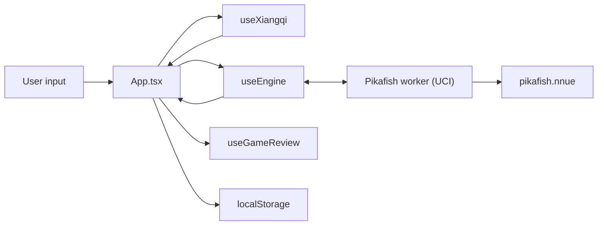

# Architecture

web-xiangqi is a single-page React app with Pikafish compiled to WebAssembly
and run in a Web Worker. Unusually for the three sibling apps, it also **builds
its own engine**: the repo carries the upstream patch set and Emscripten
overrides, and `npm run build` produces the `.wasm` artifacts the app ships.

Structured to mirror [web-katrain's `docs/architecture.md`][katrain], so the
three sibling apps can be read against each other. The third is
[web-chess][chess], which also carries [the cross-app learning plan][plan]
comparing all three and tracking what is worth moving between them.

[katrain]: https://github.com/Sir-Teo/web-katrain/blob/main/docs/architecture.md
[chess]: https://github.com/Sir-Teo/web-chess/blob/main/docs/architecture.md
[plan]: https://github.com/Sir-Teo/web-chess/blob/main/docs/cross-app-learning-plan.md

## Runtime Overview

## Two Halves of the Repo

The engine toolchain and the React app are largely independent, and most work
touches only one:

| | Engine | App |
| --- | --- | --- |
| Source | `patches/`, `templates/`, `scripts/build-pikafish.sh` | `src/` |
| Build | `npm run build` (needs emsdk) | `npm run build:react` |
| Output | `public/pikafish*.js`, `.wasm`, `.nnue` | `dist/` |
| Checks | `test:smoke`, `test:parity`, `bench:nps` | `npm test`, `npm run lint` |

`npm run build:react` deliberately cleans only the React output so the
checked-in engine artifacts survive.

## Main Thread

`src/App.tsx` is the application shell at ~5,300 lines: board, panels, modals
and all wiring. web-katrain moved the equivalent into a store; doing the same
here is the largest outstanding item in web-chess's
`docs/cross-app-learning-plan.md`.

- `src/hooks/` — `useXiangqi` (rules, move tree, game state), `useEngine`
  (worker lifecycle and UCI), `useGameReview` (the review pass),
  `useGameLibrary` (saved games).
- `src/utils/` — pure logic, and **where new logic belongs**: rules, review
  scoring, device tiering, persistence, the opening book, notation, export.
  Most of these now have a colocated `*.test.ts`.
- `src/components/` — board, panels, modals.

## Board Conventions

Easy to get backwards, and several tests exist only to pin them:

- Ranks run **bottom to top**: rank 0 is Red's back rank, rank 9 is Black's.
  FEN is written top to bottom, so `rank = 9 - visualRow`.
- Files `a`–`i` are 0–8. A square in UCI is file letter then rank digit (`e0`
  is Red's general at the start).
- Red is `'w'` and uses uppercase pieces; Black is `'b'` and lowercase.
- Evaluations are **Red-positive**, so Black loses ground when a score rises.

## Rules

`utils/xiangqi.ts` is the whole rule set: move generation, legality, check,
and the flying-general rule. `validateMoveStr` returns a reason on rejection,
which the tests assert against so a move is never rejected for the wrong rule.

### Repetition, and the rule that is not chess's

`utils/repetition.ts` is the other half, and it is the part xiangqi does
differently. A repeated position is not a draw here: the side that will not
stop checking is ruled to have **lost**, and the same goes for perpetually
chasing an unprotected piece. `gameResultForPosition` had this written down as
a comment and no code, so a player shuffling into a perpetual check saw
nothing at all.

`describeRepetition` counts occurrences along the played line and classifies
the cycle since the previous visit to the same position. A side that checked
on every one of its moves in that cycle is checking perpetually; one quiet
move ends it, which is exactly the out the rules give the checker. The board
shows a Repetition panel naming the side that has to vary.

**It stops short of chases, deliberately.** 長捉 needs to know which piece is
chased, whether it is protected, and whether the chaser threatens it or merely
stands near it, and the rulebook carves out pinned pieces, a chased piece that
is itself checking, and chasing with a general or a soldier. A guess there
would put a wrong verdict on a real game, so an unclassified cycle says "a
draw unless one side is perpetually chasing" rather than claiming to have
ruled a chase out. Nothing in the module ends a game on its own.

Position identity excludes the move counters, which differ on every visit and
would make every position unique.

## Notation

`utils/xiangqiNotation.ts` writes a move the way players read it. UCI is the
wire format and the right thing to store; it is the wrong thing to show,
because every Chinese book, every database and the World Xiangqi Federation's
own records write the first move as 炮二平五 or `C2=5`. A Move Notation
preference picks between UCI, WXF and Chinese, and it reaches the move list,
the breadcrumb, the engine's principal variations, the opening book, the
review's key moments and the eval graph's tooltip.

Three rules are easy to get backwards and all three are pinned by tests:

- **Files are numbered from each player's own right**, so the two sides
  disagree about every file except the middle one they both call five. Red's
  number is `9 - fileIndex`, black's is `fileIndex + 1`.
- **The trailing number is a distance after `+`/`-` but a destination file
  after `=`** -- and for the horse, elephant and advisor, which never move
  straight, it is a destination file either way. `R2+3` is three ranks;
  `H2+3` is a file.
- **Two of a kind on one file lose the file number** and take `+` for the one
  nearer the opponent and `-` for the one behind. "Nearer the opponent" is the
  higher rank for red and the lower for black. Only soldiers stack deeper than
  two, and then the letter goes instead and they are counted from the front.

A principal variation is **replayed**, not formatted move by move against the
starting position: which chariot is the front one, and whether a file number
needs disambiguating at all, both change as the line runs.

WXF has no answer for two files each holding a stacked pair, where `+R+1`
names two different moves; this keeps the file number in that one case. The
guarantee that matters is in `xiangqiNotation.test.ts`: it walks every legal
move in six positions and asserts no two produce the same string, because a
record is only readable if each move in it names exactly one move.

### Reading it back

`parseMoveInNotation` is the formatter run backwards, literally: it generates
the legal moves in the position and asks which one *writes* as the text it was
given. A few dozen formats per token is nothing, and it buys two properties a
hand-written parser cannot have. It can never accept an illegal move, because
it only ever offers legal ones; and it can never disagree with the formatter
about what a move is called, because it is asking the formatter. A test round
trips every legal move in five positions through both notations.

`canonicaliseNotationToken` folds the differences that are spelling rather
than meaning -- simplified against traditional, the red/black glyph split that
real records ignore, Chinese numerals against Arabic, `.` against `=`, case,
full-width characters -- and then requires the result to match one of the five
shapes a move can take. That last part is not optional: without it `2...`
folds to `2===` and a move number starts reading as a move.

Two things worth knowing before reading this code, both of which looked
plausible the other way round and are wrong:

- **The opening position is symmetric and files are numbered from each
  player's own right, so the same token names a move for either side.** `C2=5`
  is red's cannon to the middle *and* black's. That is the notation working.
- **Black's 车9平8 is the chariot on i9, not a9.** Black's file 9 is the i
  file.

The import box falls back to this when the UCI extractor finds no coordinates,
so a PGN carrying a Chinese comment is still read as a PGN. Variations are not
followed on that path: the parenthetical form is a PGN convention that a
notation record does not use.

## Engine Boundary

`useEngine` loads the lightweight `pikafish.js` wrapper first, then lazily
pulls the selected core and NNUE, so the app shell paints before the engine
arrives. It speaks UCI over `postMessage` and flushes `info` output to React
on an interval rather than per line.

Which core is loaded, how many threads, and how much hash come from
`utils/analysisProfile.ts`, which grades the device into `low` / `mid` /
`high`. Threaded cores need cross-origin isolation; the single-threaded cores
are the fallback where COOP/COEP are unavailable — which includes GitHub
Pages.

The tiering compares memory at 4, not 8, because **browsers disagree about the
top of `navigator.deviceMemory`'s range**. The spec describes clamping the
value to limit fingerprinting, and Chromium 148 was observed here reporting
`32`. The old `<= 8` test therefore put the same machine in the mid tier under
one browser and the high tier under another — sizing the engine by browser
rather than by machine. Every browser agrees that 4GB is constrained.

### The thread ceiling is the build, not the device policy

**Read this before raising the thread count.** `WASM_PTHREAD_POOL_SIZE` in
`scripts/build-pikafish.sh` prewarms that many pthread workers into the shipped
core, and it is not merely a warm-up. The engine runs inside a worker, so when
Pikafish asks for more search threads than the pool holds, the thread that asked
blocks in `pthread_create` and never returns to the event loop that would start
the new worker. Nothing errors: the engine simply never answers `readyok`, and
the app sits on "Loading engine" until the 90-second ready timeout fires.

The pool was 4, which cost most of the machine's search. It is now 12, and
`MAX_ENGINE_THREADS` stops the ask at 8 — `ENGINE_THREAD_HEADROOM` below the
pool, because the two used to be the same number and there was nowhere to be
wrong by one. `threadsForCores` applies that clamp, so a tier edit alone cannot
reach the hang.

Measured in the browser on the rebuilt SIMD core, depth 18 from the start
position, 256MB hash, 18-core machine:

| threads | 1 | 4 | 8 |
| --- | --- | --- | --- |
| nodes/second | 435k | 1.92M | 3.74M |
| wall | 2501ms | 1407ms | 625ms |

Node agrees at depth 20 — 448k / 1.80M / 3.51M — and shows 12 threads *slower*
than 8 on this machine (3.28M), which is why the ask stops at 8 rather than at
the pool. Boot cost is not what the bigger pool costs. Warm: ready in 333ms at 4 threads,
378ms at 8. Cold -- a fresh browser context, nothing cached -- the board is on
screen in about 110ms and the engine is ready in about 550ms, measured over
three runs.

The threaded core is only ever loaded on the mid and high tiers, which are
always a pointer-and-keyboard machine, so the larger pool never reaches a phone:
the low tier boots the single-threaded core, which has no pool at all.

Raising this further means raising `WASM_PTHREAD_POOL_SIZE` *and* rebuilding the
artifacts, together — `WASM_PTHREAD_POOL_SIZE=<n> npm run build`, which needs
emsdk. A source-only raise would let a tier ask for more than the shipped core
was built for.

**Four places know the pool size, and `test:engine:contract` makes them agree:**
the build script's default, the built artifacts themselves,
`ENGINE_PTHREAD_POOL_SIZE` in `analysisProfile.ts`, and `templates/pikafish.js`
— which needs it because it clamps a caller's explicit thread count, and
`Pikafish.createWorkerEngine` is a published helper. Unclamped, a browser asking
for 16 threads got a worker that timed out with nothing to read; 64 booted fine
in the same run, so the failure is timing-dependent and not findable by trying
once. Node is not clamped: the pool is a browser-worker concept and the same
artifacts run 17 threads there, which is what `bench:nps` does.

The check also compares `public/pikafish.js` and `dist/pikafish.js` against the
template they are copied from. Editing the template without rebuilding leaves
the app loading the old wrapper, and the shipped copies were 35 lines behind
when that check was added.

### The deployed site is single-threaded, and every number above is not it

**The table above is a dev-server measurement.** `vite.config.ts` sends COOP and
COEP, so every dev server and every browser check in this repo is cross-origin
isolated, gets `SharedArrayBuffer`, and loads a threaded core. **GitHub Pages
sends neither header and cannot be configured to** — it serves static files with
fixed ones. So the build a player actually loads always takes the other branch.

Same build, same machine, same start position, the only difference being the
headers on the response:

| | cross-origin isolated | GitHub Pages |
| --- | --- | --- |
| core | `threaded-simd` | `single-simd` |
| threads | 8 | 1 |
| nodes/second | 3.7M | 414k |
| live analysis settles at | D22/S49 | D16/S30 |
| engine ready | ~1.2s | ~0.4s |

Nine times the nodes and six extra plies — which is what the deployed site used
to give up, and no longer does.

**`public/coi-sw.js` puts the headers back.** A service worker sees every
same-origin response before the page does, so it can add what the host omitted;
`index.html` registers it and reloads once so the document comes back through
it. The chain is unchanged — threads need `SharedArrayBuffer`, which needs
isolation, which needs those headers — but the headers no longer have to come
from the host. Measured over a server sending none, MultiPV 3:

| | Pages as-is | Pages + `coi-sw.js` |
| --- | --- | --- |
| core | `single-simd` | `threaded-simd` |
| threads | 1 | 8 |
| nodes/second | 479k | 3.9M |
| seldepth | 31 | 41 |
| hash used | 4% | 26% |

It caches nothing on purpose. The cleanup this repo carries exists because an
older demo shipped a *caching* worker and a stale one went on serving old engine
artifacts; this one only rewrites headers on responses it fetches from the
network, so there is no cache to go stale and no build that can outlive a
deploy. Offline support is the other half of what web-chess's worker does and is
deliberately not here.

Every branch fails safe — no worker support, an insecure context, a rejected
registration, or a worker that never controls the page all leave the app
single-threaded and working. The one reload carries a sessionStorage guard so it
cannot become a loop, and the block is skipped entirely when the page is already
isolated, so the dev server and every check here register nothing. Hosting that
sends the headers itself (Netlify, Cloudflare Pages, a Worker) still skips the
worker and the reload with it.

**Reload on `controllerchange`, never on `navigator.serviceWorker.ready`.** The
two look equivalent and differ exactly where it matters. `ready` resolves as
soon as *a* registration has an active worker — and a returning visitor still
carrying the old demo worker has one, so it resolved against that, the reload
fetched a second document that had also not been through `coi-sw.js`, and the
sessionStorage guard spent itself on it and blocked the reload that would have
worked. Everyone who had used the site before stayed single-threaded, silently
and permanently. Only the controller being `coi-sw.js` means the next fetch goes
through it. `test:prod:smoke` has a third pass for this: it installs the legacy
worker first, then loads the app as a returning visitor would, because the other
two passes start from a clean browser where ours is the first worker and the
race cannot happen.

What *was* wrong is that the app did not know. Threading was resolved entirely
inside `templates/pikafish.js` — `resolveVariant` drops `threaded-simd` to
`single-simd`, `recommendedThreads` returns 1 for a non-threaded core — so the
engine was always asked for one thread and always got it. But nothing told the
app, and the app draws the dashboard. The deployed Core card read `single-simd`
and `8T · 128MB` at the same time, and Settings offered an Engine Threads ladder
— 1 2 3 4 6 8 — on which every rung was 1.

`detectThreadSupport` now sits beside `detectSimdSupport` and mirrors the
wrapper's own check, and `resolveEngineBootConfig` resolves it the way it
already resolves `saferBoot`: single variant, one thread. The count, the ladder
and the Core card's explanation all read that one config.

**Time budgets absorb this and depth ceilings do not**, which is the reason the
budget is `movetime` and the depth is a ceiling (see below). At 414k nps the
same budget simply arrives at a shallower depth instead of overrunning. Game
Review is unaffected in the way that matters — measured on a Pages-like server,
the calibration fixtures score 99% for engine self-play and 6% for arbitrary
legal moves, a 93-point separation against a gate that asks for 40, with a
30-ply review taking 10.8s. Strong play scores *higher* single-threaded, not
lower: a shallower reviewer disagrees with the played move less often.

`test:prod:smoke` runs both configurations for this reason. It used to run only
`vite preview`, which is isolated — so the deploy gate had never once loaded the
app the way the deploy serves it. Its second pass now asserts that the worker
reaches isolation and a threaded core, and the invariant that failed here in the
first place: that the dashboard's thread count agrees with what the page
actually got.

### The emsdk version is part of the engine, and is pinned

`install-emsdk.sh` used `EMSDK_VERSION=latest`, so the Pages deploy compiled the
engine with whatever emsdk was current that morning. That is not a
reproducibility nicety: today's `latest` ships a threaded core that never
becomes ready.

Emscripten **6.0.2** dropped `mainScriptUrlOrBlob` from
`INCOMING_MODULE_JS_API`, and `templates/pikafish.js` passes exactly that. The
engine module is constructed inside a worker, where `document.currentScript`
does not exist, so Emscripten's own `_scriptName` is undefined; without the key
it spawns every pthread worker as `new Worker(undefined)` — a request for the
literal path `"undefined"`, a 404, and a pool whose load dependency never
clears.

Nothing in the pipeline catches it, which is the part worth remembering:

- the changelog promises an error in *debug* builds, and this build sets
  `ASSERTIONS=0`, so the ignored key is silent;
- `test:smoke` and `test:parity` pass, because they run under Node, which never
  takes the worker path;
- the browser suite that would see it lives in `ci.yml`, and the deploy job does
  not wait for `ci.yml`.

So an engine change is only proven by watching a real browser reach `readyok`.
6.0.1 is the last release that honours the key; raising the pin means giving the
worker the core's URL another way — building with `-sEXPORT_ES6` so
`_scriptName` comes from `import.meta.url` is the supported replacement.

Engine crashes are classified rather than surfaced raw:
`shouldSuppressEngineRuntimeError` and `hasMemoryAccessOutOfBounds` keep a
WASM abort from reaching the user as an unhandled error, and a failed boot
can be retried with `saferBoot`, which drops to one thread and half the hash.

## Review and Accuracy

`utils/review.ts` scores a game on **winning chances, not centipawns**, using
Lichess's published constants — the sigmoid `0.00368208` and the accuracy
curve `103.1668 · e^(−0.04354·loss) − 3.1669`. A quality label takes the
milder of the raw centipawn reading and the practical one, so an imprecision
in a decided game is not called a blunder. (The two ladders that feeds on are
*not* calibrated against each other, and the consequences are measured below.)

Phases sit alongside that, in `utils/gamePhase.ts`:

- The phase is read from **material** rather than the move number — only the
  chariots, horses and cannons, since advisors and elephants never leave their
  own half and pawns are worth little before the river.
- It is taken from the position *before* the move, which needs no replay: a
  record already stores the board after the move and what it captured, so the
  position it was played in is the two added back together.
- Plies count from the start of the **game**. A record's `ply` counts from the
  root of the move tree, which is 1 whether the game began at move one or from
  a FEN taken at move 20, so `plyOffsetFromRootFen` reads the real offset off
  the root FEN — the same number `fullmoveForPly` already uses for display.
- `summarizeAccuracyByPhase` splits accuracy by phase and `filterKeyMoments`
  narrows the key-moment list to one. Neither is persisted: the phase is looked
  up per move, so a review restored from the library filters exactly as a fresh
  one does.

## A game does not always start from the opening

Custom-FEN setup is how anyone studies an endgame, and three things assumed it
away. Worth checking any new feature against, because the failures are quiet:
nothing errors, the screen just says something untrue.

- **The captured trays** were `standard opening set − what is on the board`.
  Load an endgame FEN and the board reported a haul of pieces the position never
  had. `utils/material.ts` now subtracts from the position the game began from,
  and reads *who is ahead* off the board rather than off the captures — those
  are two questions, and deriving the balance from captures happened to work
  only because both sides were subtracted from the same set.
- **The opening name.** `getOpeningCandidates` checked the root; `matchOpening`,
  three lines above it, did not. So a FEN study was named after one move, and
  the name reaches the saved game's label and the PGN's `[Opening]` tag. The
  guard is now inside `openings.ts` where a caller cannot forget it.
- **The review's line signature** is the moves and not the root, so two lines
  with the same moves from different roots share one. Unreachable today because
  every root-changing path calls `resetReview()` first — recorded at the
  function, because it is a coupling rather than a guarantee.

## Storage

| What | Key | Module |
| --- | --- | --- |
| Saved games | `xiangqi-game-library` | `utils/gameLibrary.ts` |
| Game in progress | `xiangqi-auto-saved-game` | `utils/autoSave.ts` |
| Preferences | `xiangqi-app-preferences` | `App.tsx` |

All localStorage, all capped, and everything read back goes through
`normalizeSavedGame`, which validates the start position against the actual
rules — two generals, both in their palaces, not facing down an open file, and
the side not to move not already in check. A record that fails is dropped
rather than reaching the board.

The auto-save stores a `SavedGame`, so restoring reuses that same validation.

### Reading the library as a repertoire

`utils/positionExplorer.ts` answers "have I been here before?" over the saved
games. It is the half of Lichess's opening explorer that needs no data source,
no network and no licence, and it is the half that is about the player.

- Keyed on `positionKey` from the repetition module rather than on a move list,
  so a transposition is found and the explorer cannot disagree with the
  repetition rule about what the same position is.
- The index is built whole per change to the library and looked up per
  position, because a lookup happens on every position stepped through.
  Measured: 24ms to index 200 games of 120 plies, 267ms for a full 500-game
  library of 1024-move games, against a 9-microsecond lookup.
- **Only the played line.** A saved game may carry a `moveTree` of variations,
  and indexing those would count a position someone *considered* beside a game
  that was played.
- **`ongoing` is not a result.** It counts toward how often a move was chosen
  and not toward how it did.

### What the user may change about the engine

Hash and threads are settable, and both are held inside what the tier allows,
because both can hang or crash the engine if they escape it:

- **Hash** is a ladder per tier — low 16/24/48, mid 32/64/128/256, high
  64/128/256/512. The ceiling is a memory judgement: the core is built with
  `MAXIMUM_MEMORY=2147483648` and the NNUE alone is 53MB on top of the engine.
  A size the tier does not offer falls back to the tier's *default*, not to the
  nearest rung it does — a preference saved on another machine is a statement
  about that machine.
- **Threads** only go *down*. The ladder is derived from what the tier already
  chose and stops there, because the ceiling is the shipped core's thread pool
  rather than a policy, and asking past it hangs the engine. The reason to want
  it is a laptop off its charger.

Both clamp ahead of the safer-boot halving, so a retry after a crash backs off
from whatever was actually in use rather than from the tier default. Changing
either reboots the engine, which takes about a third of a second and which the
labels say rather than leaving the stall unexplained.

`utils/serviceWorkerCleanup.ts` unregisters service workers from the older
demo build and clears its caches, so a stale shell cannot keep serving old
engine assets.

`utils/storage.ts` is the boundary where storage is allowed to *fail*, as
distinct from the normalizers that handle data which is present but wrong.
`readStorage`/`writeStorage`/`removeStorage` return `null`/`false` rather than
throwing, so private mode, blocked cookies and quota stop being conditions each
reader has to remember. Ported from web-katrain, which guards once at the
boundary rather than once per reader; web-chess took the same boundary.

`autoSave.ts` uses it; the library and preferences readers still carry their own
`try`/`catch`. The wrapper is for anything new and for whichever is next
touched. `autoSave` had a private `getDefaultStorage` that duplicated
`getLocalStorage` down to the `globalThis` fallback — and web-chess's `autoSave`
had independently grown the same eight lines, which is what a missing
abstraction does.

## Data Formats

- Moves are lowercase UCI (`h2e2`) everywhere, including the opening book.
- Export and import: `utils/gameExport.ts`, `utils/moveImport.ts`. The PGN
  carries the review as well as the moves — NAGs (`$6`/`$2`/`$4`) for quality
  and `{[%eval ...]}` for the evaluation after each move, both conventions other
  tools already read. `utils/pgnAnnotations.ts` writes them, and a mate goes out
  as `#3` rather than `299.97`, since the score is a sentinel and not an
  evaluation. The "Better was" text holds a legal-looking move; the importer
  strips comments before extracting moves, which is pinned by a test and swept
  over 250 generated games.

  **Read back too.** `extractAnnotatedMainLine` in `moveImport.ts` returns the
  main line *with* its annotations, and the import applies them only when they
  match the line that was actually loaded -- two parsers disagreeing about which
  moves the line holds would put an annotation on the wrong move. It has to
  tokenise rather than strip, and the order is the whole problem: `[%eval ...]`
  lives inside a `{...}` comment, so stripping `[...]` first -- which the plain
  extractor must do, because a FEN tag contains substrings that read as
  coordinates -- removes the evaluation with the headers. Consuming `{` before
  `[` takes the comment whole.

  Only the three NAGs this app writes are mapped back; the rest of the table is
  not a quality scale, and guessing would label a move nobody graded. The review
  *summary* is not restored on import, deliberately: annotations were imported,
  a review was not run.

  Sweeping generated games through both directions found a real defect in the
  exporter that reading the code did not: a mate in zero gives a distance of -0
  for black, `${-0}` is `"0"`, so black's mate wrote as `#0` and read back as
  red's. The sign now comes from the score, and the parser reads it as a
  character -- `Number('-0') >= 0` is true, so a numeric test has the same bug
  in reverse.
- Share links encode the tree as base64url: `utils/shareTree.ts`.
- The opening book is `utils/openings.ts`; a test replays every line through
  the rules engine so it can never advertise an unplayable move.
- **`utils/historicalGames.ts` is empty, and the reason is worth reading before
  refilling it.** It shipped ten move lists attributed to real, named
  grandmasters with specific events and dates, and they are not those games.
  Seven of the ten contained the identical eight-move block
  `a0a1 a9a8 a1d1 a8d8 i0i1 i9i8 i1h1 i8g8` — half the game, for four of them —
  and that block leaves both chariots facing each other down an open file, so
  `hist-1` has Hu Ronghua declining a free chariot. Two of the ten also
  contained moves that are not legal at all, and had been loading silently
  truncated: `handleLoadHistoricalGame` calls `loadMoves` without validating,
  unlike saved games, and `loadMoves` stops at the first illegal move without
  saying so, while the card's label — built from the data — advertised the full
  length.

  **What found it was running them through Game Review**: 20–28% accuracy with
  seven to ten blunders each, against 7% for a control of random moves. That is
  the check to repeat before adding any, and `npm run test:review:calibration`
  is now that check as a script — it reviews an engine self-play game and
  asserts the score stays high, so "is the review broken or is the data wrong?"
  takes thirty seconds rather than an afternoon. Entries now require a `source`, and a
  test refuses a run of eight identical moves shared between two of them.

  The general rule: any bundled move list needs the replay test, because the
  loader will not tell you, and needs provenance, because otherwise the records
  are asserted rather than checkable.

## Words the engine chose, and words a player needs

`validatePieceMove` writes its rejection reasons for the code that reads them —
"rook moves orthogonally", "pawn move is illegal". There is no rook in xiangqi,
so `utils/moveRuleHints.ts` is not decoration: its fallback (capitalise the
reason) is how a beginner gets told about a piece this game does not have, and
four reasons were reaching players that way.

The test is the interesting part, and the shape is worth copying. It holds **no
list of reasons**. It drives the rules engine over every square pair in eight
positions — four of them built for reasons the ordinary ones cannot reach: an
elephant advanced far enough to try the river, an elephant whose eye its own
soldier blocks, a general at the edge of its palace, a soldier pinned down the
file — collects whatever the engine says, and asserts every reason found has a
written sentence and every written sentence answers a reason that exists. A
hand-written list would pass forever after someone added the twenty-fifth
reason.

The hints are a lookup record rather than a `switch` so "is this reason
handled?" is a fact the test can read. Asked of the output instead, one written
sentence ("Generals cannot face each other.") reads exactly like its own
fallback and would be mistaken for one.

`PIECE_MOVE_HINTS` in `App.tsx` is the same contract in the other direction:
each names the restrictions the engine enforces on that piece, so a rule cannot
first be mentioned at the moment it refuses a move. The elephant's eye was the
one missing.

## Telling the user what the engine is doing

`utils/analysisActivity.ts` answers "what is the analysis engine doing" once,
for the three places that show it: the graph's State card, the engine
dashboard's Search card and the status line along the bottom. Each used to
decide it from a different subset of the same five booleans, and none of them
knew that live analysis stops while the tab is in the background — so a
backgrounded tab read "Engine ready" and "Idle" beside a stale depth and
looked exactly like an engine with nothing to do.

`background` outranks `searching` in the ladder because stopping a search is
asynchronous: `stop` goes out on the way and `isSearching` stays true until
the engine answers `bestmove`, so a hidden tab would otherwise flash
"Analyzing" for a position nothing will report on. It is also the only state
that does not clear itself, which is why it is the only one that gets colour
and a reason on screen.

## Depth is a ceiling; time is the budget

Every live search carries both, and stops at whichever comes first. They used to
bind the wrong way round: the high tier was capped at depth 12 with 1800ms to
spend, and the Search Depth *preference* clamps the tier's number and defaulted
to 8 — so the analysis board ran a 9ms search and sat idle for the rest of the
second, with nothing on screen saying the slider was the reason.

Measured in the browser at 8 threads, from the start position, which is about
the slowest position there is to search:

| depth | 8 | 12 | 14 | 16 | 18 | 20 | 22 |
| --- | --- | --- | --- | --- | --- | --- | --- |
| time | 9ms | 128ms | 250ms | 524ms | 1054ms | 1445ms | 4944ms |

The ceilings now sit where the move time is the binding constraint, which is the
one that adapts to the position and the machine. In the app afterwards, start
position, high tier: D13/S23 at 900k nps with three PV lines, D19/S37 at 3.6M
with one.

**MultiPV costs depth, and it is worth knowing.** Three lines is about a quarter
of the node rate and six plies. Three is still the right default for an analysis
board — candidate moves are the point — but it is a choice, not free.

**Playing on from a position.** `playFromHere` keeps the line up to the position
on screen and switches to a Play mode, taking the side to move. Switching mode
otherwise goes through `applyMode`, which resets the board — so the thing you
most want after a review finds your mistake was the thing you could not do. The
line is truncated at the current position, because playing on from move 15 means
the moves after 15 did not happen, and the human takes the side to move so the
engine never moves first.

**A deep dive is the fourth budget, and the one the user asks for.**
`resolveDeepDiveBudget` runs one search on the current position at depth 36 with
a 30s budget on a high tier, scaled down per tier. Bounded rather than `go
infinite` deliberately: infinite returns no `bestmove` until stopped, and
several paths in `App.tsx` wait on `bestmove`, so a bounded search settles on
its own and nothing has to remember to end it. It carries the same analysis tag
as the live searches, so a position change cancels it like any other search.
Measured from a four-move opening at 8 threads: live analysis settles at D17,
Go Deep reaches D26.

Three ceilings that must not be confused:

- `WORKER_SAFE_MAX_DEPTH` is the **AI opponent's** ladder, deliberately short of
  what the engine can do. It used to clamp live analysis too, so the board could
  never look deeper than the hardest opponent plays — and the traffic went the
  other way as well: the analysis preference clamped the *opponent*, so with the
  old default of 8, "Hard" and "Master" both searched depth 8 against tooltips
  promising 9 and 12. The two hardest rungs were the same opponent. The AI now
  plays `AI_DEPTH_LIMIT` and nothing else adjusts it, which is what its tooltip
  has always claimed.
- `resolveLiveAnalysisPolicy` sets the **analysis** ceiling per tier, against
  the move-time budget it has to fit inside.
- `resolveReviewPolicy` is held **below** live analysis on purpose: a review
  searches every unevaluated move, so its depth multiplies by the length of the
  game. At D16 a 30-ply review finishes in 1.6s, measured. The revisit pass is
  where the depth goes, on the few moves that turned out to matter.

## The main thread is not where the time goes

Measured, so nobody spends a night re-deriving it. `App.tsx` is ~5,400 lines in
one component with about sixty `useState` hooks, which looks like it should
re-render the world on every one of the engine's five info flushes a second. It
does not: the panels are memoized and the flush interval does its job.

Frame pacing at 1440x900 over 12 seconds, a 30-ply game, engine searching, and
the same window with live analysis off as a control:

| | median | p95 | frames > 32ms | long tasks |
| --- | --- | --- | --- | --- |
| searching | 16.7ms | 18.1ms | 0 | 0 |
| idle (Play workspace) | 16.7ms | 18.2ms | 0 | 0 |

Identical, and a flat 60fps. The heaviest workload in the app is the review
pass, and it holds up under a phone-grade CPU:

| CPU throttle | 30-ply review | frames > 32ms | longest task |
| --- | --- | --- | --- |
| none | 252ms | 0 | none |
| 6x | 1457ms | 1 | 94ms |

So `App.tsx`'s size is a **maintainability** problem — which the Project
Invariants below already treat it as — and not a performance one. Every
performance win available here has been in the engine: threads, and the depth
budget above. Look there first, and measure before assuming the shell is the
cost.

## The two grading ladders disagree, and the looser one wins

`classifyMoveQualityForEval` grades a move twice — once on centipawns, once on
winning chances — and keeps `getLessSevereReviewQuality` of the two. That is a
sound design *if* the two ladders are calibrated against each other. Here they
are independent constants, and measuring them shows they are not.

Taking each `REVIEW_THRESHOLDS` boundary and converting it to a winning-chance
loss at equality:

| boundary | centipawns | win% loss it really costs | `REVIEW_WIN_PERCENT_LOSS_THRESHOLDS` |
| --- | --- | --- | --- |
| best | 40 | 3.68 | 2 |
| good | 90 | 8.21 | 5 |
| inaccuracy | 180 | 15.99 | 20 |
| mistake | 320 | 26.46 | 30 |

The win-percent ladder is stricter at the top and looser in the middle, so they
cross. Because the milder grade wins, the looser ladder decides wherever they
disagree, and at the top the stricter one never bites at all. Measured at
equality, red to move:

- 30–90cp: the centipawn ladder is milder and wins. Harmless.
- **190–200cp: centipawns say mistake, winning chances say inaccuracy, and the
  move is graded an inaccuracy.**

That second case is the one that matters, because it happens *at equality* —
the position-aware argument for preferring winning chances does not apply when
the game is level. The centipawn ladder's own stated boundary is being
overridden by a number nobody calibrated against it.

web-chess does not have this: its win-percent thresholds are *derived* from its
centipawn ones, so the two meet exactly at equality and the milder-of-two is a
no-op safety net rather than a silent re-grading. See its
`WIN_PERCENT_LOSS_THRESHOLDS` and `qualityAgreement.test.ts`.

`gradingLadders.test.ts` records all of the above without changing any grade, so
editing either ladder now reports which grades moved and whether the two came
closer together or further apart — which is the information the decision below
actually needs.

**Whoever takes this on should know it is not only a grading decision.** A
review is persisted whole — `SavedReviewSnapshot` carries the accuracy, both
per-side accuracies, every quality count and the key moments — so changing
either ladder strands every saved review on the old scale. The library sorts on
those values and averages them across games, so old and new records would be
compared silently, exactly as happened when the per-move loss was bounded (see
the read-path clamp in `gameLibrary.ts`).

That gives three options rather than one: clamp or adjust on read as the
centipawn bound now does, re-derive a saved review from its stored annotations
when it is loaded, or version the snapshot and show old reviews as stale.

The second is what katrain does, and it is worth copying rather than inventing.
Its SGF carries only **raw** engine output — `scoreLead`, `winrate`, `visits`,
`prior` — and `katrainSgfAnalysis.ts` initialises every derived field to zero on
read and recomputes it:

    m.pointsLost = sign * (rootScoreLead - m.scoreLead);

So a change to how points-lost is derived reaches every stored game for free.
There is no migration because there is nothing stored to migrate. web-chess
lands in the same place from the other direction: its auto-save holds a PGN and
a move count, its library holds PGN, and a review is rebuilt from evaluations
every time.

This repo is the only one of the three that stores a conclusion rather than the
evidence for it, which is why it is the only one that needed a read-path clamp
and the only one where a grading change carries a migration. The annotations are
already saved per move; a summary rebuilt from them on load would remove the
whole class of problem instead of patching each instance.

**Done.** `rebuildSummaryFromAnnotations` recomputes every derived field when a
saved game is loaded, and `summaryRebuildable.test.ts` now exercises that
function rather than a copy of its arithmetic. The four fields that are facts
about the run rather than conclusions drawn from the moves -- `reviewedAt`,
`lineSignature`, `engine`, and the key moments -- are carried over from what was
stored, because nothing in the annotations can recover them. A summary written
before a scoring change now reads on the current scale instead of sorting and
averaging beside summaries that used a different one, which is what unblocks
changing the grading ladders.

Not changed here, for the reason recorded when the win-percent work was done:
altering either ladder changes grades users have already seen, and the right
ladder for xiangqi is a judgement about the game rather than something to copy
from chess. But the disagreement is now measured rather than assumed, and the
choice is between deriving one ladder from the other (chess's answer) or setting
both deliberately so they agree at equality.

## A mate wrecks the centipawn average here too

The same defect web-chess has, found by checking after it turned up there, and
larger. Not reproduced on screen — Pikafish would not load in the browser used
for this — so this is read from the code and the arithmetic, and should be
confirmed against a real mated game before it is fixed.

- `useEngine.ts` maps a mate to `MATE_SCORE_BASE = 30000` minus the distance.
  web-chess uses 10000, so the same mistake costs three times as much here.
- `getEvalLossForMove` subtracts raw and clamps only at zero, and
  `computeReviewArtifacts` sums that straight into `averageCentipawnLoss`.
- A side standing at -500 that plays into a forced mate therefore books a loss
  near 29,500. In a 40-move game that single move adds about 737 to the average.
- The *quality label* is unaffected, because `getWinningChancePercent` bounds
  the evaluation with `WIN_PERCENT_EVAL_LIMIT` before taking a winning-chance
  figure. So, exactly as in chess, the label stays sensible while the centipawn
  figure beside it does not.

**Fixed**, with the same 1000cp bound web-chess uses — one bug with two
constants, so one answer. Confirmed without the engine first: because
`useEngine` encodes the mate itself, the sentinel values are known and
everything after them is arithmetic. A six-move review whose ordinary moves cost
tens of centipawns was averaging 5017; `reportedCentipawnLoss` now bounds what
is summed, and the review note carries a "+" when it has been bounded rather
than showing a bound as though measured. The raw swing is still on the
annotation for anything that wants it.

## What `npm run verify` covers, and what it does not

`npm run verify` runs typecheck, lint, the vitest suite, `test:openings`,
`test:library`, `test:engine:contract`, `test:smoke`, `test:parity` and
`build:react` — everything in CI's "React app checks" step except `npm audit`,
which is left out so the command works offline, plus the engine scripts that
need no toolchain.

**It stays browser-free on purpose.** Everything in it runs with no Chromium
installed, which is what lets it work offline; that is why `test:prod:smoke`
is *not* in it despite being cheap.

It is **not** the whole of CI, but the gap is narrower than it looks. CI also
installs emsdk, rebuilds the Pikafish WASM (`npm run build`), and runs a
Playwright worker-parity check. Only the *rebuild* needs the emscripten
toolchain: the shipped `.wasm` files are checked into `public/`, so the engine
scripts run here against them without emsdk —

    npm run test:smoke     # loads Pikafish, searches, returns a bestmove
    npm run test:parity    # 337,764 nodes, ~321k nodes/second

Both pass locally. So a change to the worker protocol or the engine wrapper *can*
be caught before CI; what cannot is a change to the build itself — the patch,
the emscripten templates or `build-pikafish.sh` — since that rebuild is the step
requiring the toolchain. `verify` runs both, because they are cheap: smoke is 0.5s and parity 1.5s
against a 4.3s command, so the engine is covered for the price of rounding.

### Which gate is upstream of a deploy

The distinction that matters is not local-versus-CI but **what runs before
`dist` is uploaded**. `ci.yml` is not upstream of the Pages job, so a red suite
there does not stop a publish — which is exactly how a broken engine could have
shipped.

Two checks were added for that reason, and both sit where the deploy will see
them:

- `test:engine:contract` reads the built engine artifacts and asserts what
  `templates/pikafish.js` and `analysisProfile.ts` assume about them. Static, so
  it runs inside `verify` without a browser or a toolchain.
- `test:prod:smoke` serves `dist` with `vite preview` and loads it. Every other
  browser suite here drives the *dev* server, so the bundle that gets uploaded
  was the one thing nothing had ever loaded. It runs as its own step in
  `deploy-pages.yml`, after `verify`, with a Chromium install — deliberately
  shallow, because its job is to catch a broken deploy, not to re-test the UI.
- `test:review:calibration` runs an engine self-play game through the whole
  review pipeline and asserts strong play still scores strongly. The scoring
  *functions* were already covered by fixtures; what was not was the pipeline
  end to end, which is the difference between "the review is broken" and "the
  data is wrong" — a distinction that cost an afternoon once.

This distinction is worth stating because the failure it prevents already
happened twice in one night: `npm test` does not run `test:openings` or
`test:library` (they are standalone scripts, which is why `verify` now calls
them), and a check that reports success is only telling you about the things it
looked at.

## The tab order is a budget

Every focusable thing is a key press between someone and the control they want,
and two of this app's lists grow with the game. `Board.tsx` fixed its share
first — every occupied square was `tabIndex={0}`, so reaching the move list from
the toolbar meant Tab thirty-two times through pieces — and the reasoning
generalises.

Measured on a 30-ply game, tab stops before the bottom command bar:

| | stops on the page | before the bar |
| --- | --- | --- |
| before the breadcrumb change | 91 | 83 |
| after | 61 | 53 |

`utils/rovingFocus.ts` holds the arithmetic: which item carries the stop
(wherever focus was last left, then whatever is current, then the last item) and
where a key moves it (ends do not wrap — a strip representing a sequence should
not jump from the last move back to the first). The case that bites is a
remembered index the list has since outgrown, which happens every time someone
steps back and plays a different move.

**The move tree is the remaining half**, at one stop per ply. The same fix
applies but it is not the same shape: the breadcrumb is a linear strip, and the
tree is rows of red/black chips plus variation rows, so it needs two-dimensional
movement and a decision about whether arrows enter a variation. That is a
judgement about the primary navigation surface rather than a mechanical change,
which is why it is written down here rather than guessed at.

## Project Invariants

- Ranks are bottom-up and evaluations are Red-positive. When in doubt, write
  the test first.
- New pure logic goes in `src/utils/` with a colocated test, not into
  `App.tsx`. This governs *new* logic: `App.tsx` already holds a pile of
  top-level helpers that predate it, so it is "stop adding", not a description
  of the current state. Most are six lines or fewer.

  **The three this list used to name as deserving tests are done** —
  `initialPanelWidth` (with `clampPanelWidth` and `stepPanelWidth`, which share
  its arithmetic) is `utils/panelWidth.ts`, `serializeSavedMoveTree` is
  `utils/savedMoveTree.ts`, and `formatMoveRuleHint` is `utils/moveRuleHints.ts`.
  Each turned out to encode a rule learned from a defect that nothing pinned:
  a width below the minimum collapses rather than snapping open, the tree
  serializer's `seen` set is copied per branch so a transposition is not
  silently dropped, and every rejection reason needs a sentence or it reaches a
  player as the engine's own words. `utils/material.ts` came out the same way,
  and that one was carrying a live bug.

  The moment to extract one is when you are about to *edit* it. web-chess hit
  exactly this: a pure label helper was changed in place while a bound was
  added, altering the text under every review row with nothing asserting it.
- A mobile-like device is always the `low` tier; `resolveEngineBootConfig`
  depends on that and a test pins it. The low tier boots the single-threaded
  core, which is what keeps the threaded core's prewarmed thread pool off
  phones.
- Storage readers must never throw on bad data; drop the record and move on.
- A non-finite `evalScore` used to blank the eval graph rather than dent it: it
  reached the `d` attribute, where SVG discards the *entire* path, and it
  poisoned both extent reduces, taking the axis with them. The clamp did not
  help, since `Math.max(-limit, Math.min(limit, NaN))` is `NaN`. **Fixed**, both
  halves together, because fixing only the stroke would have left the graph
  broken. A non-finite score now means what it already meant everywhere else in
  that component — this ply has no evaluation — so it is not carried forward and
  the extent is taken over the finite points.

  That is the same shape as `clampWinPercentLoss` on the review path: guard once
  where the value arrives, and nothing downstream has to re-check. Prefer it to
  the sibling approaches — web-chess drops the point, so the line joins across a
  gap as though nothing were missing; web-katrain breaks the stroke, which keeps
  a missing evaluation legible and is the one to copy if the graph ever needs to
  distinguish "no reading" from "unchanged".
- The checked-in engine artifacts in `public/` are the shipped engine.
  `build:react` must not delete them.
- A capability value read from a browser API needs its documented range
  checked before a threshold is chosen against it.
