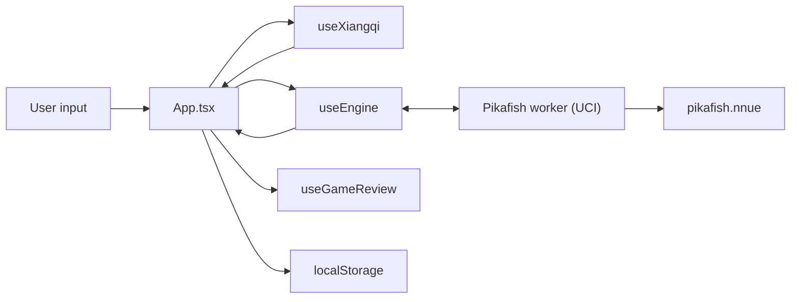

# Architecture

web-xiangqi is a single-page React app with Pikafish compiled to WebAssembly
and run in a Web Worker. Unusually for the three sibling apps, it also **builds
its own engine**: the repo carries the upstream patch set and Emscripten
overrides, and `npm run build` produces the `.wasm` artifacts the app ships.

Structured to mirror [web-katrain's `docs/architecture.md`][katrain], so the
three sibling apps can be read against each other. The third is
[web-chess][chess], which also carries [the cross-app learning plan][plan]
comparing all three and tracking what is worth moving between them.

[katrain]: https://github.com/Sir-Teo/web-katrain/blob/main/docs/architecture.md
[chess]: https://github.com/Sir-Teo/web-chess/blob/main/docs/architecture.md
[plan]: https://github.com/Sir-Teo/web-chess/blob/main/docs/cross-app-learning-plan.md

## Runtime Overview

## Two Halves of the Repo

The engine toolchain and the React app are largely independent, and most work
touches only one:

| | Engine | App |
| --- | --- | --- |
| Source | `patches/`, `templates/`, `scripts/build-pikafish.sh` | `src/` |
| Build | `npm run build` (needs emsdk) | `npm run build:react` |
| Output | `public/pikafish*.js`, `.wasm`, `.nnue` | `dist/` |
| Checks | `test:smoke`, `test:parity`, `bench:nps` | `npm test`, `npm run lint` |

`npm run build:react` deliberately cleans only the React output so the
checked-in engine artifacts survive.

## Main Thread

`src/App.tsx` is the application shell at ~4,950 lines: board, panels, modals
and all wiring. web-katrain moved the equivalent into a store; doing the same
here is the largest outstanding item in web-chess's
`docs/cross-app-learning-plan.md`.

- `src/hooks/` — `useXiangqi` (rules, move tree, game state), `useEngine`
  (worker lifecycle and UCI), `useGameReview` (the review pass),
  `useGameLibrary` (saved games).
- `src/utils/` — pure logic, and **where new logic belongs**: rules, review
  scoring, device tiering, persistence, the opening book, notation, export.
  Most of these now have a colocated `*.test.ts`.
- `src/components/` — board, panels, modals.

## Board Conventions

Easy to get backwards, and several tests exist only to pin them:

- Ranks run **bottom to top**: rank 0 is Red's back rank, rank 9 is Black's.
  FEN is written top to bottom, so `rank = 9 - visualRow`.
- Files `a`–`i` are 0–8. A square in UCI is file letter then rank digit (`e0`
  is Red's general at the start).
- Red is `'w'` and uses uppercase pieces; Black is `'b'` and lowercase.
- Evaluations are **Red-positive**, so Black loses ground when a score rises.

## Rules

`utils/xiangqi.ts` is the whole rule set: move generation, legality, check,
and the flying-general rule. `validateMoveStr` returns a reason on rejection,
which the tests assert against so a move is never rejected for the wrong rule.

## Engine Boundary

`useEngine` loads the lightweight `pikafish.js` wrapper first, then lazily
pulls the selected core and NNUE, so the app shell paints before the engine
arrives. It speaks UCI over `postMessage` and flushes `info` output to React
on an interval rather than per line.

Which core is loaded, how many threads, and how much hash come from
`utils/analysisProfile.ts`, which grades the device into `low` / `mid` /
`high`. Threaded cores need cross-origin isolation; the single-threaded cores
are the fallback where COOP/COEP are unavailable — which includes GitHub
Pages.

The tiering compares memory at 4, not 8, because **browsers disagree about the
top of `navigator.deviceMemory`'s range**. The spec describes clamping the
value to limit fingerprinting, and Chromium 148 was observed here reporting
`32`. The old `<= 8` test therefore put the same machine in the mid tier under
one browser and the high tier under another — sizing the engine by browser
rather than by machine. Every browser agrees that 4GB is constrained.

Engine crashes are classified rather than surfaced raw:
`shouldSuppressEngineRuntimeError` and `hasMemoryAccessOutOfBounds` keep a
WASM abort from reaching the user as an unhandled error, and a failed boot
can be retried with `saferBoot`, which drops to one thread and half the hash.

## Review and Accuracy

`utils/review.ts` scores a game on **winning chances, not centipawns**, using
Lichess's published constants — the sigmoid `0.00368208` and the accuracy
curve `103.1668 · e^(−0.04354·loss) − 3.1669`. A quality label takes the
milder of the raw centipawn reading and the practical one, so an imprecision
in a decided game is not called a blunder.

## Storage

| What | Key | Module |
| --- | --- | --- |
| Saved games | `xiangqi-game-library` | `utils/gameLibrary.ts` |
| Game in progress | `xiangqi-auto-saved-game` | `utils/autoSave.ts` |
| Preferences | `xiangqi-app-preferences` | `App.tsx` |

All localStorage, all capped, and everything read back goes through
`normalizeSavedGame`, which validates the start position against the actual
rules — two generals, both in their palaces, not facing down an open file, and
the side not to move not already in check. A record that fails is dropped
rather than reaching the board.

The auto-save stores a `SavedGame`, so restoring reuses that same validation.

`utils/serviceWorkerCleanup.ts` unregisters service workers from the older
demo build and clears its caches, so a stale shell cannot keep serving old
engine assets.

## Data Formats

- Moves are lowercase UCI (`h2e2`) everywhere, including the opening book.
- Export and import: `utils/gameExport.ts`, `utils/moveImport.ts`.
- Share links encode the tree as base64url: `utils/shareTree.ts`.
- The opening book is `utils/openings.ts`; a test replays every line through
  the rules engine so it can never advertise an unplayable move.

## Project Invariants

- Ranks are bottom-up and evaluations are Red-positive. When in doubt, write
  the test first.
- New pure logic goes in `src/utils/` with a colocated test, not into
  `App.tsx`.
- A mobile-like device is always the `low` tier; `resolveEngineBootConfig`
  depends on that and a test pins it.
- Storage readers must never throw on bad data; drop the record and move on.
- If the eval graph ever goes blank rather than wrong, suspect a non-finite
  `evalScore`. `EvalGraph` carries the last seen value forward with
  `typeof x === 'number'`, which admits `NaN`, and a single `NaN` reaches the
  SVG path and invalidates the whole line rather than one point. Left as-is
  because the loose check is the house idiom here and nothing has been shown
  to produce a `NaN` score — but it is the first place to look.

  The review path is worth contrasting, because it is safe for a reason worth
  copying rather than by luck: `clampWinPercentLoss` returns 0 for anything
  non-finite, and every accuracy figure — the summary, the per-side split, the
  per-phase breakdown — is derived through it. One guard at the boundary makes
  everything downstream safe without each display having to re-check. `EvalGraph`
  has no such boundary, which is why it is the exposed one.

  web-chess solves the graph case a third way worth stealing if this is ever
  touched: `buildWinrateSeries` drops a point whose evaluation is not finite
  (`if (!isFiniteNumber(cp)) continue`) instead of carrying the last value
  forward. A missing point leaves a gap in the line; a carried-forward `NaN`
  destroys the whole line. Same hazard, and the sibling already has the better
  answer — so the choice here is between three positions, not two, and the
  cheapest fix is not a new idiom but a copy.
- The checked-in engine artifacts in `public/` are the shipped engine.
  `build:react` must not delete them.
- A capability value read from a browser API needs its documented range
  checked before a threshold is chosen against it.
